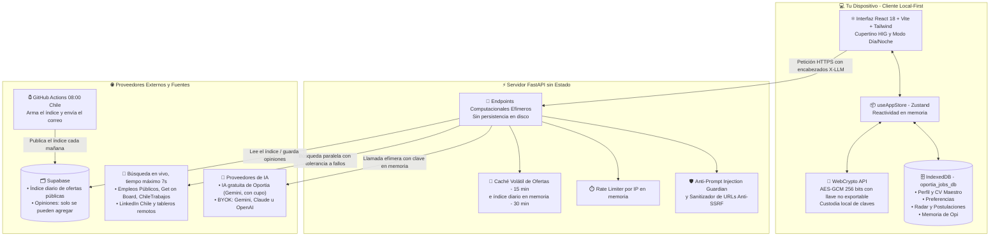

# Oportia Jobs IA — Tu talento. Tus decisiones. Tus oportunidades.

<div align="center">

[](https://github.com/alejandroham/Oportia.jobs/actions/workflows/ci.yml)
[](CHANGELOG.md)
[](PRIVACY.md)
[](SECURITY.md)
[](https://vercel.com/new/clone?repository-url=https%3A%2F%2Fgithub.com%2Falejandroham%2FOportia.jobs)
[](LICENSE)
[](https://github.com/sponsors/alejandroham)
[](https://www.instagram.com/not.kano/)

<p align="center">
  <strong>Tú manejas tu información. Nosotros te traemos las ofertas.</strong><br>
  Ofertas de empleo de todo Chile cada mañana, compatibilidad con IA, CV y carta a la medida, y el copiloto <strong>Opi</strong>. Tu perfil y tus postulaciones se guardan en tu navegador; el CV se lee en el servidor y se descarta al instante (arquitectura <strong>Local-First sin estado</strong>, <strong>Ley N° 21.719 de Chile</strong>).
</p>

[**📖 Leer el Manual de Usuario »**](docs/MANUAL_DE_USUARIO.md) · [**🛡️ Política de Privacidad »**](PRIVACY.md) · [**📜 Términos de Uso »**](TERMINOS.md) · [**🔒 Política de Seguridad »**](SECURITY.md) · [**📝 Registro de Cambios »**](CHANGELOG.md)

</div>

---

## 🧭 ¿Qué es Oportia Jobs IA?

**Oportia Jobs IA** resuelve la fragmentación, el spam de postulaciones y la falta de privacidad en el mercado laboral contemporáneo:

> **La IA organiza y te orienta. Tú decides tu camino.**

- **Tú manejas tu información; Oportia te trae las ofertas.** Tu CV, tu perfil y tus postulaciones se guardan en tu navegador: sin cuenta y sin base de datos de candidatos. Descargas un respaldo cifrado o lo borras todo cuando quieras.
- **Para todas las áreas, no solo tecnología:** salud, educación, comercio, construcción, logística, administración, sector público y oficios. La búsqueda reconoce sinónimos y equivalentes en inglés (enfermera ↔ TENS ↔ nurse; técnico en construcción ↔ supervisor de obra ↔ capataz).
- **Tu primera búsqueda trae ofertas de verdad:** al terminar la guía, Oportia busca con tu profesión y sus nombres equivalentes (por ejemplo, TENS y Técnico en Enfermería) más las palabras clave de tu CV, no con el titular literal.
- **Índice diario de ofertas:**
  - Cada mañana, a las 08:00 de Chile, se reúnen cientos de ofertas, y la búsqueda las consulta al instante.
  - Fuentes: Empleos Públicos, Get on Board, **portales de empleo de las empresas** (Greenhouse, Lever, Ashby, SmartRecruiters) y ChileTrabajos. Solo se usan fuentes que permiten este uso.
  - Cada oferta muestra **cuándo vence**: la fecha de cierre o una estimación. Las vencidas se ocultan.
  - Opcionalmente, un correo diario con las ofertas nuevas. Ver [docs/INDICE_DIARIO.md](docs/INDICE_DIARIO.md).
- **Tu CV, analizado con IA:**
  - La IA separa tu experiencia laboral, tus títulos y tus cursos. "Reanalizar con IA" corrige tu perfil sin volver a subir el archivo.
  - En la guía de inicio revisas cada experiencia (cargo, empresa y fechas) y con un botón intercambias cargo y empresa si quedaron al revés.
  - En **Qué busco** te propone **cargos afines a tu experiencia**, cada uno con un resumen de por qué calza.
  - En **Mis logros** extrae tus logros en formato STAR, sin inventar cifras.
  - Opi también actualiza tu perfil, lo que buscas y tus logros desde el chat.
- **Compatibilidad automática:**
  - Con la IA activa, cada oferta muestra tu porcentaje sin que lo pidas.
  - Si cambias tu experiencia o lo que Opi sabe de ti, Oportia te avisa para recalcularlo.
  - "Calza con tu perfil" muestra, sin IA, qué palabras tuyas aparecen en la oferta.
  - **"En mi región"** usa siempre la región actual de tu perfil, y el filtro rápido y el de "Más filtros" muestran la misma región.
- **Resultados honestos:** Oportia nunca muestra un puntaje que la IA no calculó ("Sin evaluar"). Si la IA está con mucha demanda, te avisa con un botón **Reintentar** y no descuenta tu cupo; lo que se leyó sin IA lleva la etiqueta "Lectura básica (sin IA)".
- **CV compatible con sistemas ATS, sin datos inventados:**
  - Oportia arma el CV con tus datos: "Cargo — Empresa", "Mes Año – Mes Año | Ciudad", logros y tecnologías respaldadas por tu perfil; títulos de sección estándar; PDF con Arial, sin palabras partidas.
  - Se ajusta solo a **1 o 2 hojas** (los cargos de hace más de 10 años van en "Experiencia anterior").
  - Muestra tu **% de coincidencia** con la oferta y las palabras clave que te faltan, y una revisión ATS antes de descargar.
  - Lo que la IA agregue sin estar en tu perfil se quita y se te avisa. Si un cargo aparece con fechas distintas, Oportia te pregunta.
- **Postulas con documentos a la medida:** CV y carta adaptados a cada oferta, en PDF, con el resumen de la oferta y el correo o enlace para postular, más preparación de entrevista y brechas con cursos de cualquier área (SENCE, ChileValora, Coursera y edX). Tú postulas en el enlace oficial: Oportia no envía postulaciones automáticas.
- **IA gratuita o tu propia clave:** la IA gratuita de Oportia tiene cupo diario, **doble confirmación** y un comprobante descargable; **tu nombre, correo, teléfono y RUT nunca se envían a la IA**. Con tu clave de Gemini, OpenAI o Claude la usas sin límite. Buscar ofertas y armar tu CV funciona también sin IA. La IA gratuita usa **Gemini 3.6 Flash** con respaldo rápido **Gemini 3.5 Flash-Lite**; si Google viene fallando, el indicador se pone ámbar ("IA con demanda") y Oportia avisa al instante sin descontar tu cupo.
- **Cambiar de equipo:** "Recupera tus datos" en la portada restaura tu respaldo `.oportia`.
- **Ofertas de otros portales:** botones "Buscar también en" abren tu búsqueda en Indeed, Computrabajo, Laborum, LinkedIn y la Bolsa Nacional de Empleo; si te gusta una oferta, pegas su texto y Oportia la ordena y la guarda en tus postulaciones (solo para ti).
- **En celular, tablet y computador:** bajo 1024 px la navegación va en la barra inferior y Opi es un botón redondo que no tapa los botones; sin desplazamiento horizontal entre 360 y 1366 px. Una dirección que no existe muestra "No encontramos esta página".
- **Accesible (WCAG 2.2 AA):** sin violaciones serias ni críticas de axe-core en las 6 secciones principales, en modo claro y oscuro; diálogos con el foco atrapado, pestañas con roles ARIA, enlace "Saltar al contenido" y sin animaciones si tu sistema pide reducir el movimiento.
- **Privacidad a la vista:** la Política de privacidad y los Términos de uso se leen dentro de la app (`/privacidad` y `/terminos`), desde el pie de página, Ajustes y la guía de inicio, antes de subir tu CV.
- **Tu opinión cuenta:** 👍/👎 de un toque, una tarjeta pequeña y el botón **Opinión** del menú; contacto solo con tu autorización.

<p align="center"></p>

---

## 🏗️ Arquitectura Local-First y Backend sin Estado (Opción A)



### Garantías Principales de la Arquitectura
1. **Tus datos viven en tu navegador:** Tu perfil, experiencias, postulaciones y memoria se guardan en `IndexedDB`. La interfaz usa endpoints sin estado que reciben los datos en cada petición y no los guardan.
   > ⚠️ **Transición en curso:** el backend aún conserva endpoints heredados (por ejemplo `PUT /api/profile`, `PUT /api/preferences`, `POST /api/jobs/scrape`) y el servidor MCP, que leen y escriben archivos en `data/`. La interfaz web ya no los usa para el flujo principal; están pensados para la instalación local y se retirarán en una próxima versión.
2. **Custodia de Claves de IA en el Cliente:** Tus claves de API se cifran localmente con `WebCrypto` (AES-GCM de 256 bits) usando una llave **no exportable** guardada en IndexedDB. Viajan protegidas en encabezados HTTPS solo al invocar funciones de IA y el backend las descarta de memoria inmediatamente tras recibir la respuesta del proveedor.
3. **Sin base de datos de candidatos:** El backend no tiene base de datos de usuarios. Los CV subidos se procesan en un archivo temporal que se elimina apenas se extrae el texto.

---

## 🌟 Los Módulos del Sistema

| Módulo | Ruta | Icono | Descripción Funcional |
| :--- | :---: | :---: | :--- |
| **Conoce Oportia** | `/conoce-oportia` | ✨ | Portada de presentación (se muestra en la primera visita): qué es Oportia, cómo funciona en 3 pasos, áreas, fuentes, privacidad e IA. |
| **Inicio** | `/` | 🏠 | Panel de control con tarjeta inteligente de *Siguiente paso recomendado*, checklist de avance del candidato y métricas en tiempo real. |
| **Buscar empleo** | `/empleos` | 🛰️ | Índice diario y búsqueda en vivo; "Para ti" con tus palabras clave; compatibilidad con IA automática y aviso si tu perfil cambió; "Calza con tu perfil"; vencimiento de cada oferta; filtros por modalidad, región y fuente (incluye portales de empresas). |
| **Mis postulaciones** | `/postulaciones` | 🎯 | Postulaciones por estado, con su porcentaje y su vencimiento. *Resumen de la oferta* con el correo o enlace para postular. Pestañas: *Documentos* (CV ATS y carta en PDF, largo y experiencias, ajuste a 1–2 hojas, revisión ATS y % de coincidencia), *Preparar entrevista* e *Historial y notas*. Se activa al subir el CV. |
| **Aprender** | `/aprender` | 🎓 | *Mis brechas*: requisitos de tus ofertas frente a tu CV, con evidencia. *Cursos* de SENCE, ChileValora, Coursera y edX. *Mi ruta* y *Practicar*. Se activa al subir el CV. |
| **Mi perfil** | `/perfil` | 👤 | *Mi CV*: análisis con IA, "Reanalizar con IA", datos personales con región y comuna, y edición de experiencia, títulos, cursos, enlaces, idiomas y palabras clave, ordenados por fecha o a mano. *Qué busco*: cargos sugeridos con su resumen. *Mis logros* en formato STAR. *Lo que Opi sabe de mí*. |
| **Ajustes** | `/ajustes` | ⚙️ | IA gratuita de Oportia (doble confirmación, aviso de exclusión de responsabilidad, comprobante y cupo diario) o clave propia; apariencia clara u oscura; respaldo cifrado `.oportia`; "Borrar todos mis datos" con doble confirmación. |
| **Copiloto Opi** | Flotante | 💬 | Asistente que conversa, te orienta y actualiza tu perfil, lo que buscas y tus logros (siempre con tu confirmación). |
| **Opinión** | Menú, pie y página | 💬 | 👍/👎 de un toque, tarjeta de cinco caras tras unos minutos de uso y formulario con contacto voluntario y enlace de donación. |

---

## 👥 Comité Oportia (5 Evaluadores Colegiados)

Oportia Jobs IA evalúa cada oferta convocando a 5 perspectivas colegiadas con ponderación transparente:

```text
                       ┌────────────────────────────┐
                       │   Director del Comité      │
                       │   (Síntesis y Veredicto)   │
                       └─────────────┬──────────────┘
                                     │
         ┌──────────────┬────────────┴───┬──────────────┬──────────────┐
         ▼              ▼                ▼              ▼              ▼
   ┌───────────┐  ┌───────────┐    ┌───────────┐  ┌───────────┐  ┌───────────┐
   │ Reclutador│  │  Hiring   │    │Especialista│ │Filtro ATS │  │ Estratega │
   │   RRHH    │  │  Manager  │    │  Técnico  │  │(Screening)│  │de Carrera │
   │   (25%)   │  │   (25%)   │    │   (25%)   │  │   (15%)   │  │   (10%)   │
   └───────────┘  └───────────┘    └───────────┘  └───────────┘  └───────────┘
```

- **Dual Score:** Puntaje Actual (lo demostrado hoy) vs Puntaje Potencial (proyección tras capacitarse).
- **Evidencias Citadas:** Citas textuales de tu CV justificando requisitos cumplidos, parciales y no cumplidos.
- **IA Honesta:** Si no tienes clave configurada, no se inventan puntuaciones falsas; el sistema te orienta con transparencia para continuar manualmente o conectar tu proveedor preferido.

---

## 🚀 Inicio Rápido

### Requisitos del Sistema
- **Node.js:** v20.19 o superior (con `npm`)
- **Python:** v3.11 o superior (con `pip` y soporte de `venv`)

### Opción 1: Lanzador Rápido en 1 Clic (Recomendado)

- **macOS / Linux:**
  ```bash
  ./start_app.sh
  ```
- **Windows:**
  Haz doble clic en `start_app.bat` (o ejecuta `./start_app.ps1` en PowerShell).

El lanzador valida dependencias, compila el frontend y levanta la aplicación en `http://localhost:8000` (o `http://localhost:3000` en desarrollo).

### Opción 2: Inicio Manual

1. **Backend (FastAPI):**
   ```bash
   python -m venv venv
   source venv/bin/activate  # En Windows: .\venv\Scripts\activate
   pip install -r requirements.txt
   python run.py             # Servidor iniciado en http://localhost:8000
   ```

2. **Frontend (React + Vite + Tailwind — en otra terminal):**
   ```bash
   cd frontend
   npm install
   npm run dev               # Interfaz disponible en http://localhost:3000
   ```

---

## 🧪 Pruebas Automatizadas y Calidad Continua

El proyecto cuenta con una suite integral de pruebas con **100% de ejecución offline** y cero dependencias de red externa:

```bash
# 1. Pruebas de Backend (Pytest — 273 pruebas unitarias y de integración offline)
pytest backend/tests -v

# 2. Pruebas de Frontend (Vitest — 213 pruebas unitarias en entorno happy-dom)
cd frontend && npm test

# 3. Flujos End-to-End (Playwright — 46 pruebas en Chromium headless, incluye el PDF del CV, anchos de 360 a 1366 px y accesibilidad con axe-core)
cd frontend && npm run test:e2e

# 4. Verificación de Tipos TypeScript y Build de Producción
cd frontend && npm run build

# 5. Regenerar las capturas del manual de usuario (datos de demostración ficticios)
cd frontend && npm run docs:screenshots
```

**Cambiar la versión:** la versión vive solo en `frontend/package.json`. Para publicar una nueva, desde `frontend/` ejecuta `npm version 1.6.13 --no-git-tag-version`: actualiza `package.json` y `package-lock.json`, y la app (pie y Ajustes) y la API (`/api/status`) la leen de ahí.

El pipeline de **GitHub Actions** ([.github/workflows/ci.yml](.github/workflows/ci.yml)) ejecuta automáticamente estas suites en cada commit y pull request en ramas de desarrollo.

---

## ☁️ Despliegue en Producción

- **Vercel (Frontend Estático / Serverless):** Configuración oficial en `vercel.json`. Construye el paquete cliente en `frontend/dist` y enruta llamadas `/api/*` a la función serverless en `api/index.py`. Ver [docs/DESPLIEGUE_VERCEL.md](docs/DESPLIEGUE_VERCEL.md).
- **Render / Railway / Fly.io (Backend Completo):**
  - Render: Configurado mediante `render.yaml`.
  - Docker / Contenedores: Ejecuta `python run.py` escuchando en el puerto `$PORT` asignado por la plataforma.
- **Índice diario y correo (opcional):** GitHub Actions + Supabase Storage + Resend; configuración en [docs/INDICE_DIARIO.md](docs/INDICE_DIARIO.md).
- **IA gratuita de Oportia (opcional):** define `GEMINI_API_KEY` en el servidor con una clave de un proyecto de Google **sin facturación** (plan gratuito). Ajusta el cupo con `SHARED_AI_DAILY_LIMIT_PER_USER`, `SHARED_AI_DAILY_LIMIT_PER_IP` y `SHARED_AI_DAILY_LIMIT_TOTAL` (ver `.env.example`). Sin esa variable, solo funciona la clave propia de cada persona.

---

## 🔌 Servidor Model Context Protocol (MCP)

Oportia Jobs IA incluye un servidor nativo **MCP** para integrar tu radar y postulaciones como herramienta de contexto en clientes como **Claude Desktop**, **Cursor** o **Gemini CLI**.

> ℹ️ El servidor MCP es solo para **instalación local**: lee y guarda en la carpeta `data/` de tu equipo, no en el navegador, por lo que no ve los datos que cargaste en la interfaz web.

```json
{
  "mcpServers": {
    "oportia-jobs": {
      "command": "python",
      "args": ["run_mcp.py"],
      "cwd": "/ruta/a/Oportia.jobs",
      "env": {
        "GEMINI_API_KEY": "tu_clave_de_gemini"
      }
    }
  }
}
```

---

## 🛡️ Privacidad y Seguridad

- Consulta los detalles normativos de la **Ley N° 21.719 de Chile**, el modelo de datos Local-First y los derechos ARCO en [PRIVACY.md](PRIVACY.md).
- Revisa el modelo de amenazas, las defensas anti-prompt injection, mitigaciones SSRF y la política de divulgación responsable en [SECURITY.md](SECURITY.md).

---

## 💖 Comunidad, Autor y Patrocinio

**Oportia Jobs IA** es un proyecto de código abierto creado y mantenido con dedicación por **Alejandro Ham** para devolver el control, la dignidad y la transparencia a las personas que buscan trabajo.

- 📸 **Instagram Oficial:** [https://www.instagram.com/not.kano/](https://www.instagram.com/not.kano/) — Sigue a **`@not.kano`** para novedades, consejos de empleabilidad y contacto directo.
- ❤️ **GitHub Sponsors:** [https://github.com/sponsors/alejandroham](https://github.com/sponsors/alejandroham) — Tu patrocinio financia infraestructura de pruebas y el desarrollo continuo de herramientas libres.
- 🐙 **Repositorio Oficial:** [https://github.com/alejandroham/Oportia.jobs](https://github.com/alejandroham/Oportia.jobs)
- 📖 **Manual de Usuario:** [docs/MANUAL_DE_USUARIO.md](docs/MANUAL_DE_USUARIO.md)

---

## 👥 Créditos

- **Alejandro Ham** — autor, creador y director del proyecto ([github.com/alejandroham](https://github.com/alejandroham)).
- **Gemini** vía Google Antigravity — implementación asistida de parte del código.
- **Claude** vía Claude Code (Anthropic) — diagnóstico, planificación, implementación y revisión asistidas.

Las herramientas de IA asistieron el desarrollo; la autoría y la titularidad del proyecto son de Alejandro Ham. Detalle en [CONTRIBUTORS.md](CONTRIBUTORS.md).

---

## 📄 Licencia

Distribuido bajo la **Licencia Apache 2.0** ([LICENSE](LICENSE)). © 2026 Alejandro Ham.

Puedes usar, modificar y redistribuir Oportia, también con fines comerciales, siempre que:

1. **Conserves** los archivos [`LICENSE`](LICENSE) y [`NOTICE`](NOTICE) y los avisos de autoría.
2. **Indiques** de forma visible qué archivos modificaste.
3. **No uses la marca:** la licencia no da permiso para usar los nombres "Oportia" ni "Opi", ni sus logotipos e ilustraciones (sección 6 de la licencia).
