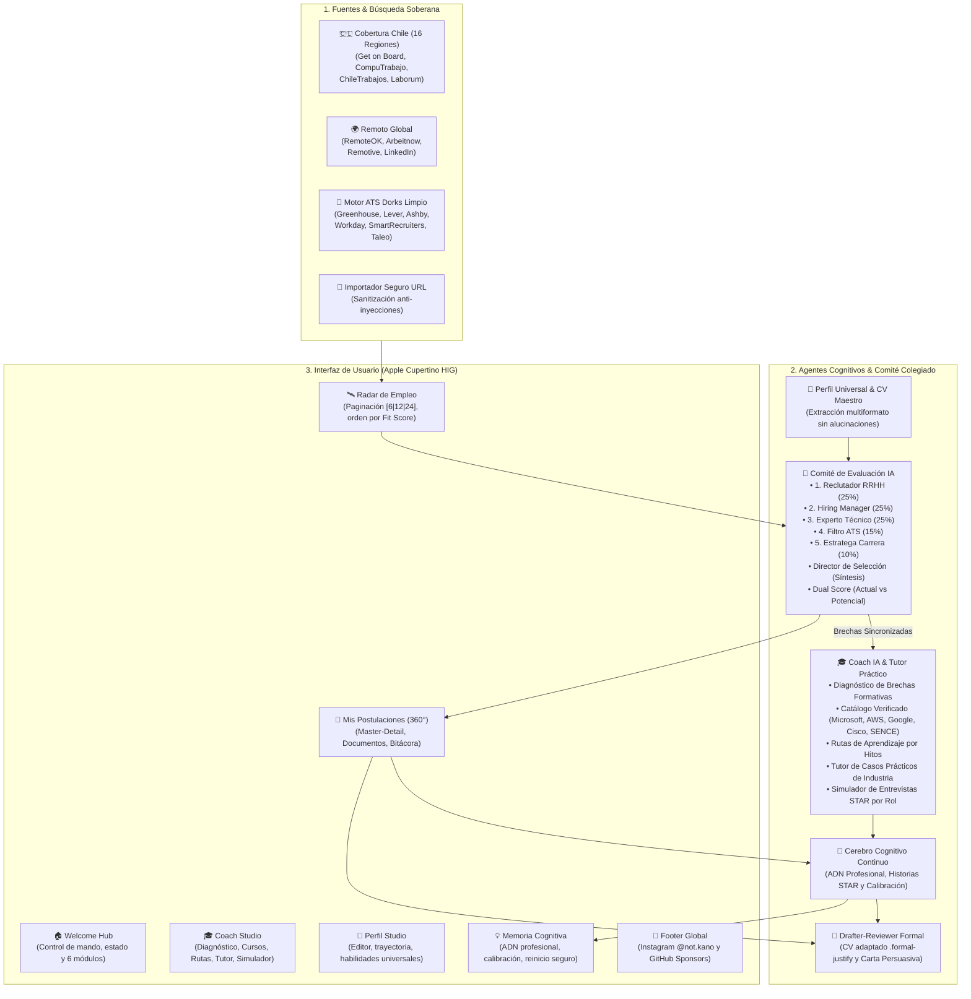

# NexusJob AI — Ecosistema Autónomo de Empleabilidad, Comité de Selección IA & Coach Profesional

<div align="center">

[](https://github.com/sponsors/alejandroham)
[](https://www.instagram.com/not.kano/)
[](docs/MANUAL_DE_USUARIO.md)
[](LICENSE)
[](docs/MANUAL_DE_USUARIO.md#9-privacidad-respaldos-cifrados-aes-256--ley-n-21719)

<p align="center">
  <strong>Un ecosistema inteligente, ético y soberano para dominar la búsqueda de empleo.</strong><br>
  Equipado con un <strong>Comité Colegiado de 5 Evaluadores IA</strong>, <strong>Coach de Carrera y Tutor Práctico</strong>, <strong>Cerebro Cognitivo de Memoria Continua</strong>, diseño inspirado en <strong>Apple (Cupertino HIG)</strong>, cumplimiento con la <strong>Ley N° 21.719 de Chile</strong> y servidor nativo <strong>Model Context Protocol (MCP)</strong>.
</p>

[**📖 Leer el Manual de Usuario Completo »**](docs/MANUAL_DE_USUARIO.md)

</div>

---

## 🧭 ¿Qué es NexusJob AI?

**NexusJob AI** resuelve la fragmentación y falta de transparencia del mercado laboral moderno. En lugar de ser un simple formulario con un prompt de IA, opera como un **copiloto soberano de empleabilidad** donde:
- **La IA asume el 95% del trabajo técnico:** Rastrea ofertas nacionales y globales, convoca a un **Comité de Selección de 5 evaluadores**, proyecta tu **Potential Fit Score**, redacta tu CV y carta a la medida con logros STAR reales y te entrena para superar tus brechas formativas con cursos gratuitos verificados.
- **Tú mantienes el 100% del control soberano:** No usamos bots a ciegas que arriesguen tu cuenta. Tú validas tus antecedentes bajo la Ley N° 21.719 y postulas en **1 clic en el enlace oficial de la empresa**, incluso en portales estatales que exigen ClaveÚnica.

---

## 🏗️ Arquitectura General del Ecosistema



---

## 🌟 Los 6 Módulos del Sistema

| Módulo | Icono | Descripción Funcional |
| :--- | :---: | :--- |
| **Página Principal (Welcome Hub)** | 🏠 | Monitor de estado del sistema, acceso rápido a los 6 módulos, acciones en 1 clic y garantías legales. |
| **Perfil & CV Studio** | 👤 | Carga inteligente de currículum (PDF/Word), extracción sin alucinaciones y taxonomía universal de profesiones. |
| **Radar de Empleo** | 🛰️ | Exploración en las 16 regiones de Chile y remotas globales, orden descendente por Fit Score y ATS Dorks. |
| **Comité de Evaluación IA** | 👥 | Análisis colegiado con 5 evaluadores, veredicto del Director, Dual Score (Actual vs Potencial) y matriz de requisitos. |
| **Coach IA & Superación** | 🎓 | Diagnóstico de brechas, catálogo de cursos gratuitos certificados, rutas por hitos, tutor de casos y simulador STAR. |
| **Mis Postulaciones** | 🎯 | Flujo 360° con CV adaptado `.formal-justify`, carta de presentación, selector de papel formal y bitácora inviolable. |
| **Memoria Cognitiva** | 🧠 | Cerebro que acumula tu ADN profesional, biblioteca de logros STAR validados y asistente conversacional Nexus. |

👉 Para conocer a fondo cada pantalla con recomendaciones visuales, consulta el **[Manual de Usuario](docs/MANUAL_DE_USUARIO.md)**.

---

## 👥 Comité de Evaluación IA (5 Evaluadores + Director)

A diferencia de los analizadores tradicionales con puntuaciones ciegas, NexusJob AI reúne a un **Comité Colegiado de Selección**:

```
                       ┌────────────────────────────┐
                       │   Director de Selección    │
                       │   (Síntesis y Veredicto)   │
                       └─────────────┬──────────────┘
                                     │
         ┌──────────────┬────────────┴───┬──────────────┬──────────────┐
         ▼              ▼                ▼              ▼              ▼
   ┌───────────┐  ┌───────────┐    ┌───────────┐  ┌───────────┐  ┌───────────┐
   │ Reclutador│  │  Hiring   │    │Especialista│ │Filtro ATS │  │ Estratega │
   │   RRHH    │  │  Manager  │    │  Técnico  │  │(Screening)│  │de Carrera │
   │   (25%)   │  │   (25%)   │    │   (25%)   │  │   (15%)   │  │   (10%)   │
   └───────────┘  └───────────┘    └───────────┘  └───────────┘  └───────────┘
```

- **Dual Score de Compatibilidad:**
  - **Fit Score Actual (0-100%):** Lo que demuestras hoy en tu currículum frente a la vacante.
  - **Potential Fit Score (0-100%):** Tu proyección alcanzable al completar las capacitaciones recomendadas por el Coach IA.
- **Matriz de Requisitos vs CV:** Evidencias textuales categorizadas en *Cumplido*, *Parcial* o *No Cumplido*.
- **Veredicto del Director:** Dictamen ejecutivo (*Postular Inmediatamente*, *Con Ajustes*, *Brecha Crítica* o *Descartar*).
- **Acción Inmediata:** Botón **"Transferir al Coach IA"** que envía las brechas detectadas al plan de capacitación con 1 clic.

---

## 🎓 Coach IA & Centro de Superación Profesional

El nuevo módulo de **Coach IA** acompaña al candidato durante todo su desarrollo profesional:

1. **Diagnóstico de Competencias:** Mapeo de brechas con indicadores de nivel actual vs requerido e impacto proyectado en puntos.
2. **Catálogo de Cursos Verificados:** Enlaces oficiales y gratuitos sin enlaces rotos:
   - **Microsoft Learn** (Azure, DevOps, IA, C#).
   - **AWS Skill Builder** (Cloud, Arquitectura, Serverless).
   - **Cisco Networking Academy** (Ciberseguridad, Redes, Linux).
   - **Google Cloud Skills Boost** (Cloud Computing, Big Data, Gemini).
   - **SENCE Chile / Talento Digital** (Capacitación gratuita para Chile con código SENCE).
   - **Coursera & edX** (Especializaciones universitarias).
3. **Rutas de Aprendizaje por Hitos:** Planes estructurados paso a paso con objetivos, horas sugeridas y proyectos prácticos.
4. **Tutor de Casos Prácticos:** Resuelve desafíos reales de la industria y recibe una evaluación instantánea con nota `/100` y la solución recomendada.
5. **Simulador de Entrevistas por Rol:** Entrena con preguntas conductuales y técnicas frente al Reclutador de RRHH, el Líder Técnico, el Hiring Manager o el Director con retroalimentación **STAR**.

---

## 🛡️ Privacidad, Cifrado Militar & Ley N° 21.719 de Chile

NexusJob AI implementa los más altos estándares de **Privacy by Design**:
- **Zero-Knowledge & Local-First:** Tus datos se guardan exclusivamente en tu navegador (IndexedDB) y en tu máquina local (`data/`). Cero recolección oculta en servidores externos.
- **Cifrado AES-256 en Respaldos (`.nexusjob`):** Exporta e importa tus datos protegidos con **AES-GCM de 256 bits y derivación PBKDF2** bajo tu propia clave.
- **Derecho al Olvido (Art. 17 Ley 21.719):** Un botón de purga total elimina permanentemente el 100% de tus datos con una sola acción.
- **Custodia Segura de Claves:** Tus API Keys de Gemini, OpenAI o Claude nunca se exponen ni se guardan en texto plano.

---

## 🚀 Inicio Rápido

### Opción A: Lanzador en 1 Clic (Recomendado)

- **macOS / Linux:**
  ```bash
  ./start_app.sh
  ```
- **Windows:**
  Haz doble clic en `start_app.bat` (o ejecuta `./start_app.ps1` en PowerShell).

El instalador configura el entorno virtual, compila la interfaz y abre el sistema automáticamente en `http://localhost:8000`.

### Opción B: Ejecución Manual

```bash
# 1. Backend (FastAPI)
python -m venv venv
source venv/bin/activate  # En Windows: .\venv\Scripts\activate
pip install -r backend/requirements.txt
cd backend
python -m uvicorn app.main:app --host 127.0.0.1 --port 8000

# 2. Frontend (React + Vite + TailwindCSS)
cd frontend
npm install
npm run dev
```

Abre **http://localhost:3000** en tu navegador.

---

## 🔌 Servidor Model Context Protocol (MCP)

Conecta NexusJob AI como backend de datos de empleo para **Claude Desktop**, **Cursor** o **Gemini CLI**:

```json
{
  "mcpServers": {
    "nexusjob-ai": {
      "command": "python",
      "args": ["run_mcp.py"],
      "cwd": "/ruta/a/Job-Search-All-IA",
      "env": {
        "GEMINI_API_KEY": "tu_clave_de_gemini"
      }
    }
  }
}
```

---

## 💖 Comunidad, Autor y Patrocinio (GitHub Sponsors)

NexusJob AI es desarrollado con dedicación por **Alejandro Ham** como una herramienta de código abierto para devolver el control y la transparencia laboral a las personas.

- 📸 **Instagram Oficial:** [https://www.instagram.com/not.kano/](https://www.instagram.com/not.kano/) — Sigue a **`@not.kano`** para novedades de desarrollo, tips de empleabilidad y retroalimentación directa.
- ❤️ **Conviértete en Sponsor:** [https://github.com/sponsors/alejandroham](https://github.com/sponsors/alejandroham) — Tu patrocinio financia servidores de prueba, conectores de empleo actualizados y nuevas capacidades de IA libres para todos.
- 🐙 **Repositorio GitHub:** [https://github.com/alejandroham/Job-Search-All-IA](https://github.com/alejandroham/Job-Search-All-IA)
- 📖 **Manual de Usuario:** [docs/MANUAL_DE_USUARIO.md](docs/MANUAL_DE_USUARIO.md)

---

## 📄 Licencia

Distribuido bajo la Licencia **MIT**. Consulta [LICENSE](LICENSE) para más detalles.
