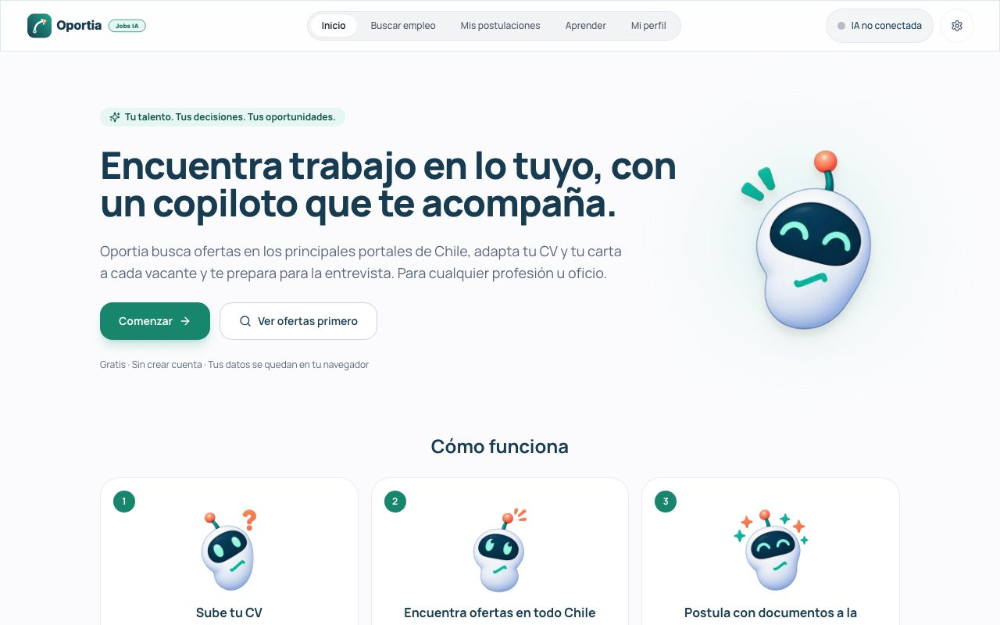
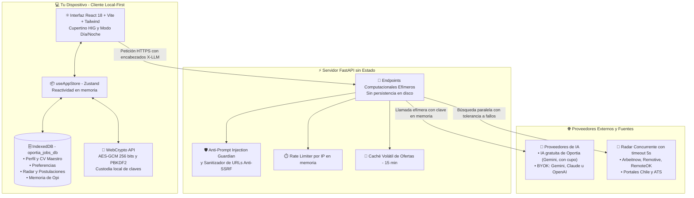

# Oportia Jobs IA — Tu talento. Tus decisiones. Tus oportunidades.

<div align="center">

[](https://github.com/alejandroham/Oportia.jobs/actions/workflows/ci.yml)
[](CHANGELOG.md)
[](PRIVACY.md)
[](SECURITY.md)
[](https://vercel.com/new/clone?repository-url=https%3A%2F%2Fgithub.com%2Falejandroham%2FOportia.jobs)
[](LICENSE)
[](https://github.com/sponsors/alejandroham)
[](https://www.instagram.com/not.kano/)

<p align="center">
  <strong>El ecosistema inteligente que automatiza tu búsqueda laboral, protege tu información y te acompaña en tu desarrollo profesional.</strong><br>
  Equipado con el copiloto <strong>Opi</strong>, <strong>Comité Oportia (5 Evaluadores)</strong>, <strong>Opi Coach y Oportia Aprende</strong>, <strong>Oportia Radar</strong>, arquitectura <strong>Local-First sin estado</strong>, cumplimiento estricto con la <strong>Ley N° 21.719 de Chile</strong> y servidor nativo <strong>Model Context Protocol (MCP)</strong>.
</p>

[**📖 Leer el Manual de Usuario »**](docs/MANUAL_DE_USUARIO.md) · [**🛡️ Política de Privacidad »**](PRIVACY.md) · [**🔒 Política de Seguridad »**](SECURITY.md) · [**📝 Registro de Cambios »**](CHANGELOG.md)

</div>

---

## 🧭 ¿Qué es Oportia Jobs IA?

**Oportia Jobs IA** resuelve la fragmentación, el spam de postulaciones y la falta de privacidad en el mercado laboral contemporáneo:

> **La IA organiza y te orienta. Tú decides tu camino.**

- **Automatización asistida con autonomía humana:** Rastrea vacantes en las 16 regiones de Chile y remotas globales, convoca al **Comité Oportia**, calcula la **Compatibilidad Oportia** con citas textuales verificables de tu currículum, redacta CVs y cartas adaptadas con logros STAR y te conecta con cursos gratuitos certificados.
- **Para todas las áreas, no solo tecnología:** salud, educación, comercio, construcción, logística, administración, sector público y oficios. La búsqueda reconoce sinónimos y equivalentes en inglés (enfermera ↔ TENS ↔ nurse).
- **Índice diario de ofertas (1.3):** cada mañana a las 08:00 de Chile se arma un índice de cientos de ofertas, que la búsqueda consulta al instante. Viene de Empleos Públicos, GetOnBoard, portales de empleo de empresas y ChileTrabajos, y solo usa fuentes que permiten este uso. Opcionalmente, envía un correo con las ofertas nuevas del día. Ver [docs/INDICE_DIARIO.md](docs/INDICE_DIARIO.md).
- **Tu perfil guía la búsqueda (1.3):** "Para ti" trae ofertas para tus palabras clave, y cada tarjeta muestra qué palabras de tu perfil calzan. La sección Brechas compara tu CV con lo que piden las ofertas y propone cursos de cualquier área.
- **IA gratuita o tu propia clave:** quien no tiene clave de IA puede activar la IA gratuita de Oportia (con cupo diario y aviso de privacidad); quien la tiene, la usa sin límite.
- **Soberanía y control absoluto:** No usamos bots que arriesguen tus cuentas. Tus datos solo salen de tu navegador hacia el proveedor de IA que tú eliges (Gemini, OpenAI o Claude) cuando usas una función de IA. Postulas siempre en **1 clic en el enlace oficial de la empresa o portal estatal con ClaveÚnica**.

<p align="center"></p>

---

## 🏗️ Arquitectura Local-First y Backend sin Estado (Opción A)



### Garantías Principales de la Arquitectura
1. **Tus datos viven en tu navegador:** Tu perfil, experiencias, postulaciones y memoria se guardan en `IndexedDB`. La interfaz usa endpoints sin estado que reciben los datos en cada petición y no los guardan.
   > ⚠️ **Transición en curso:** el backend aún conserva endpoints heredados (por ejemplo `PUT /api/profile`, `PUT /api/preferences`, `POST /api/jobs/scrape`) y el servidor MCP, que leen y escriben archivos en `data/`. La interfaz web ya no los usa para el flujo principal; están pensados para la instalación local y se retirarán en una próxima versión.
2. **Custodia de Claves de IA en el Cliente:** Tus claves de API se cifran localmente con `WebCrypto` (AES-GCM de 256 bits). Viajan protegidas en encabezados HTTPS solo al invocar funciones de IA y el backend las descarta de memoria inmediatamente tras recibir la respuesta del proveedor.
3. **Sin base de datos de candidatos:** El backend no tiene base de datos de usuarios. Los CV subidos se procesan en un archivo temporal que se elimina apenas se extrae el texto.

---

## 🌟 Los Módulos del Sistema

| Módulo | Ruta | Icono | Descripción Funcional |
| :--- | :---: | :---: | :--- |
| **Conoce Oportia** | `/conoce-oportia` | ✨ | Portada de presentación (se muestra en la primera visita): qué es Oportia, cómo funciona en 3 pasos, áreas, fuentes, privacidad e IA. |
| **Inicio** | `/` | 🏠 | Panel de control con tarjeta inteligente de *Siguiente paso recomendado*, checklist de avance del candidato y métricas en tiempo real. |
| **Buscar empleo** | `/empleos` | 🛰️ | Radar de empleo en Chile (16 regiones) y remoto global, filtros por modalidad y región, orden por compatibilidad y alerta de resiliencia ante caídas de fuentes. |
| **Mis postulaciones** | `/postulaciones` | 🎯 | Lista filtrable por estado y ficha de cada postulación con 3 pestañas (*Documentos*, *Preparar entrevista*, *Historial y notas*), cambio de estado en 1 clic y generador de CV adaptado y carta formal. |
| **Aprender** | `/aprender` | 🎓 | 4 pestañas: *Mis brechas* (habilidades que piden tus ofertas), *Cursos*, *Mi ruta* (plan de estudio) y *Practicar* (desafíos evaluados con IA). |
| **Mi perfil** | `/perfil` | 👤 | Editor de currículum modular por bloques plegables, extractor automático multiformato (PDF/Word) y preferencias laborales unificadas. |
| **Ajustes** | `/ajustes` | ⚙️ | IA gratuita de Oportia (con aviso de privacidad y cupo diario) o clave propia de IA (BYOK), selector de apariencia (Claro/Oscuro/Sistema), respaldos cifrados `.oportia` y botón de purga total inmediata. |
| **Copiloto Opi** | Flotante | 💬 | Asistente conversacional inteligente disponible en todo momento con biblioteca de sugerencias rápidas contextuales. |

---

## 👥 Comité Oportia (5 Evaluadores Colegiados)

Oportia Jobs IA evalúa cada oferta convocando a 5 perspectivas colegiadas con ponderación transparente:

```text
                       ┌────────────────────────────┐
                       │   Director del Comité      │
                       │   (Síntesis y Veredicto)   │
                       └─────────────┬──────────────┘
                                     │
         ┌──────────────┬────────────┴───┬──────────────┬──────────────┐
         ▼              ▼                ▼              ▼              ▼
   ┌───────────┐  ┌───────────┐    ┌───────────┐  ┌───────────┐  ┌───────────┐
   │ Reclutador│  │  Hiring   │    │Especialista│ │Filtro ATS │  │ Estratega │
   │   RRHH    │  │  Manager  │    │  Técnico  │  │(Screening)│  │de Carrera │
   │   (25%)   │  │   (25%)   │    │   (25%)   │  │   (15%)   │  │   (10%)   │
   └───────────┘  └───────────┘    └───────────┘  └───────────┘  └───────────┘
```

- **Dual Score:** Puntaje Actual (lo demostrado hoy) vs Puntaje Potencial (proyección tras capacitarse).
- **Evidencias Citadas:** Citas textuales de tu CV justificando requisitos cumplidos, parciales y no cumplidos.
- **IA Honesta:** Si no tienes clave configurada, no se inventan puntuaciones falsas; el sistema te orienta con transparencia para continuar manualmente o conectar tu proveedor preferido.

---

## 🚀 Inicio Rápido

### Requisitos del Sistema
- **Node.js:** v20.0.0 o superior (con `npm`)
- **Python:** v3.11 o superior (con `pip` y soporte de `venv`)

### Opción 1: Lanzador Rápido en 1 Clic (Recomendado)

- **macOS / Linux:**
  ```bash
  ./start_app.sh
  ```
- **Windows:**
  Haz doble clic en `start_app.bat` (o ejecuta `./start_app.ps1` en PowerShell).

El lanzador valida dependencias, compila el frontend y levanta la aplicación en `http://localhost:8000` (o `http://localhost:3000` en desarrollo).

### Opción 2: Inicio Manual

1. **Backend (FastAPI):**
   ```bash
   python -m venv venv
   source venv/bin/activate  # En Windows: .\venv\Scripts\activate
   pip install -r requirements.txt
   python run.py             # Servidor iniciado en http://localhost:8000
   ```

2. **Frontend (React + Vite + Tailwind — en otra terminal):**
   ```bash
   cd frontend
   npm install
   npm run dev               # Interfaz disponible en http://localhost:3000
   ```

---

## 🧪 Pruebas Automatizadas y Calidad Continua

El proyecto cuenta con una suite integral de pruebas con **100% de ejecución offline** y cero dependencias de red externa:

```bash
# 1. Pruebas de Backend (Pytest — 164 pruebas unitarias y de integración offline)
pytest backend/tests -v

# 2. Pruebas de Frontend (Vitest — 87 pruebas unitarias en entorno happy-dom)
cd frontend && npm test

# 3. Flujo Crítico End-to-End (Playwright — Chromium headless)
cd frontend && npm run test:e2e

# 4. Verificación de Tipos TypeScript y Build de Producción
cd frontend && npm run build

# 5. Regenerar las capturas del manual de usuario (datos de demostración ficticios)
cd frontend && npm run docs:screenshots
```

El pipeline de **GitHub Actions** ([.github/workflows/ci.yml](.github/workflows/ci.yml)) ejecuta automáticamente estas suites en cada commit y pull request en ramas de desarrollo.

---

## ☁️ Despliegue en Producción

- **Vercel (Frontend Estático / Serverless):** Configuración oficial en `vercel.json`. Construye el paquete cliente en `frontend/dist` y enruta llamadas `/api/*` a la función serverless en `api/index.py`. Ver [docs/DESPLIEGUE_VERCEL.md](docs/DESPLIEGUE_VERCEL.md).
- **Render / Railway / Fly.io (Backend Completo):**
  - Render: Configurado mediante `render.yaml`.
  - Docker / Contenedores: Ejecuta `python run.py` escuchando en el puerto `$PORT` asignado por la plataforma.
- **Índice diario y correo (opcional):** GitHub Actions + Supabase Storage + Resend; configuración en [docs/INDICE_DIARIO.md](docs/INDICE_DIARIO.md).
- **IA gratuita de Oportia (opcional):** define `GEMINI_API_KEY` en el servidor con una clave de un proyecto de Google **sin facturación** (plan gratuito). Ajusta el cupo con `SHARED_AI_DAILY_LIMIT_PER_USER`, `SHARED_AI_DAILY_LIMIT_PER_IP` y `SHARED_AI_DAILY_LIMIT_TOTAL` (ver `.env.example`). Sin esa variable, solo funciona la clave propia de cada persona.

---

## 🔌 Servidor Model Context Protocol (MCP)

Oportia Jobs IA incluye un servidor nativo **MCP** para integrar tu radar y postulaciones como herramienta de contexto en clientes como **Claude Desktop**, **Cursor** o **Gemini CLI**.

> ℹ️ El servidor MCP es solo para **instalación local**: lee y guarda en la carpeta `data/` de tu equipo, no en el navegador, por lo que no ve los datos que cargaste en la interfaz web.

```json
{
  "mcpServers": {
    "oportia-jobs": {
      "command": "python",
      "args": ["run_mcp.py"],
      "cwd": "/ruta/a/Oportia.jobs",
      "env": {
        "GEMINI_API_KEY": "tu_clave_de_gemini"
      }
    }
  }
}
```

---

## 🛡️ Privacidad y Seguridad

- Consulta los detalles normativos de la **Ley N° 21.719 de Chile**, el modelo de datos Local-First y los derechos ARCO en [PRIVACY.md](PRIVACY.md).
- Revisa el modelo de amenazas, las defensas anti-prompt injection, mitigaciones SSRF y la política de divulgación responsable en [SECURITY.md](SECURITY.md).

---

## 💖 Comunidad, Autor y Patrocinio

**Oportia Jobs IA** es un proyecto de código abierto creado y mantenido con dedicación por **Alejandro Ham** para devolver el control, la dignidad y la transparencia a las personas que buscan trabajo.

- 📸 **Instagram Oficial:** [https://www.instagram.com/not.kano/](https://www.instagram.com/not.kano/) — Sigue a **`@not.kano`** para novedades, consejos de empleabilidad y contacto directo.
- ❤️ **GitHub Sponsors:** [https://github.com/sponsors/alejandroham](https://github.com/sponsors/alejandroham) — Tu patrocinio financia infraestructura de pruebas y el desarrollo continuo de herramientas libres.
- 🐙 **Repositorio Oficial:** [https://github.com/alejandroham/Oportia.jobs](https://github.com/alejandroham/Oportia.jobs)
- 📖 **Manual de Usuario:** [docs/MANUAL_DE_USUARIO.md](docs/MANUAL_DE_USUARIO.md)

---

## 👥 Créditos

- **Alejandro Ham** — autor, creador y director del proyecto ([github.com/alejandroham](https://github.com/alejandroham)).
- **Gemini** vía Google Antigravity — implementación asistida de parte del código.
- **Claude** vía Claude Code (Anthropic) — diagnóstico, planificación, implementación y revisión asistidas.

Las herramientas de IA asistieron el desarrollo; la autoría y la titularidad del proyecto son de Alejandro Ham. Detalle en [CONTRIBUTORS.md](CONTRIBUTORS.md).

---

## 📄 Licencia

Distribuido bajo la **Licencia Apache 2.0** ([LICENSE](LICENSE)). © 2026 Alejandro Ham.

Puedes usar, modificar y redistribuir Oportia, también con fines comerciales, siempre que:

1. **Conserves** los archivos [`LICENSE`](LICENSE) y [`NOTICE`](NOTICE) y los avisos de autoría.
2. **Indiques** de forma visible qué archivos modificaste.
3. **No uses la marca:** la licencia no da permiso para usar los nombres "Oportia" ni "Opi", ni sus logotipos e ilustraciones (sección 6 de la licencia).
