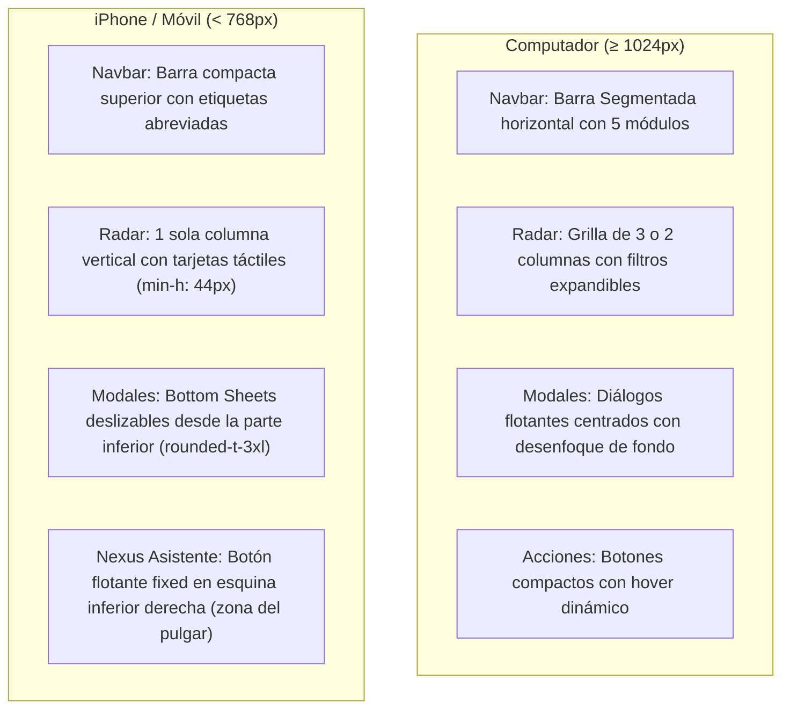

# ESPECIFICACIONES TÉCNICAS DE DISEÑO VISUAL UI/UX — NEXUSJOB AI
## Sistema de Diseño Cupertino HIG, Paleta Cromática y Arquitectura Responsiva (iPhone / Desktop)

**Versión del documento:** 1.0.0  
**Estado:** Documento para Revisión y Aprobación  
**Plataformas objetivo:** Web Desktop (macOS, Windows, Linux) y Web Mobile (iOS Safari / iPhone, iPad, Android)  
**Fecha de emisión:** 8 de Noviembre de 2026  

---

## 1. Filosofía de Diseño e Identidad Visual

NexusJob AI implementa las directrices de interfaz de usuario de **Apple (Cupertino Human Interface Guidelines - HIG)**, priorizando:

1. **Claridad sobre el adorno:** El contenido profesional (currículum vitae, ofertas laborales y análisis dimensional) es el protagonista.
2. **Vidrio Esmerilado (*Cupertino Glassmorphism*):** Uso de superficies translúcidas con desenfoque Gaussiano en tiempo real (`backdrop-filter: blur(20px)`), permitiendo una sensación de profundidad y ligereza espacial.
3. **Líneas capilares (*Hairline Borders*):** Delimitación precisa de tarjetas y paneles mediante bordes de `1px` con opacidades sutiles (del 6% al 12%), eliminando bordes toscos o pesados.
4. **Soporte Nativo Dual (Light / Dark Mode):** Transición automática y fluida entre un entorno luminoso y un Modo Oscuro profundo basado en negros absolutos OLED (`#000000`).

---

## 2. Paleta de Colores y Tokens Semánticos

Los estilos están centralizados en `frontend/tailwind.config.js` y `frontend/src/index.css`.

### 2.1. Superficies y Fondos Base

| Token / Clase | Modo Claro (*Light Mode*) | Modo Oscuro (*Dark Mode*) | Descripción y Aplicación |
| :--- | :--- | :--- | :--- |
| `body` (Lienzo principal) | `#FBFBFD` | `#000000` | Fondo general de la aplicación. En oscuro aprovecha paneles OLED de iPhone. |
| `.apple-glass` (Paneles translúcidos) | `rgba(255, 255, 255, 0.72)` | `rgba(28, 28, 30, 0.75)` | Barra superior, cajones deslizables, modales y tarjetas elevadas. |
| `.apple-card` (Superficie de tarjeta) | `box-shadow: 0 4px 20px -2px rgba(0,0,0,0.05)` | `box-shadow: 0 8px 24px -4px rgba(0,0,0,0.5)` | Elevación con sombras difusas multicapa sin líneas duras. |
| Bordes de contenedor | `rgba(0, 0, 0, 0.06)` | `rgba(255, 255, 255, 0.08)` | Bordes sutiles para delimitar zonas de contenido. |

### 2.2. Jerarquía Tipográfica y Contraste de Texto

| Nivel de Texto | Modo Claro | Modo Oscuro | Aplicación |
| :--- | :--- | :--- | :--- |
| **Texto Primario** | `#1D1D1F` (*Carbon Slate*) | `#F5F5F7` (*Platinum White*) | Títulos de ofertas, nombre del usuario, encabezados H1-H3. |
| **Texto Secundario** | `#86868B` / `gray-500` | `#A1A1A6` / `gray-400` | Metadatos de empresas, fechas de publicación, comunas y descripciones. |
| **Texto Terciario / Muted** | `#A1A1A6` / `gray-400` | `zinc-500` | Etiquetas de apoyo, marcas temporales y notas legales al pie. |

### 2.3. Colores de Acento, Marca y Semáforo Semántico

| Categoría | Valor Hex / Tailwind | Propósito en la Interfaz |
| :--- | :--- | :--- |
| **Azul Acción Primario** | `#0071E3` (*Light*) / `#0A84FF` (*Dark*) | Botones principales ("Postular", "Guardar", switches activos). |
| **Gradiente Nexus AI** | `from-blue-600 via-indigo-600 to-sky-400` | Botón del Asistente Nexus, insignias de IA y barra de marca. |
| **Alta Compatibilidad (Fit ≥ 85%)** | `emerald-600` / `bg-emerald-500/10` | Insignia de oferta con coincidencia sobresaliente. |
| **Compatibilidad Favorable (60% - 84%)** | `blue-600` / `bg-blue-500/10` | Insignia de vacante con buen ajuste profesional. |
| **Alerta / CV Faltante (< 60%)** | `amber-600` / `bg-amber-500/10` | Advertencia de brechas formativas o invitación a cargar CV. |
| **Exclusiones / Deal-Breakers** | `rose-600` / `bg-rose-500/10` | Condición eliminatoria detectada o acción destructiva (purga). |

---

## 3. Pila Tipográfica y Tratamiento de Documentos

### 3.1. Tipografía de Sistema
```css
font-family: -apple-system, BlinkMacSystemFont, "SF Pro Display", "SF Pro Text", "Helvetica Neue", Arial, sans-serif;
```
* **En iOS (iPhone):** Safari invoca de forma nativa la tipografía **San Francisco (SF Pro)**, otorgando la misma experiencia táctil y óptica que las aplicaciones del sistema de Apple.
* **Ajustes de renderizado óptico:** En `index.css` se activa `font-feature-settings: "cv02", "cv03", "cv04", "cv11"` para caracteres numéricos limpios y puntuación alineada.

### 3.2. Formato de Documentos de Postulación (`.printable-cv`)
Para la vista previa e impresión en PDF del currículum adaptado:
* **Modo Papel Blanco:** `background: #ffffff; color: #111827;` con sombra perimetral de hoja impresa.
* **Justificación formal (.formal-justify):** `text-align: justify; text-justify: inter-word; hyphens: auto;` para evitar huecos en la lectura.
* **Listas de logros:** Las viñetas de logros STAR se mantienen estrictamente alineadas a la izquierda para preservar la legibilidad según estándares ATS internacionales.

---

## 4. Adaptabilidad Responsiva: Desktop vs. iPhone (Mobile)

Para garantizar que la experiencia sea igual de eficiente en un monitor amplio de computador que en la pantalla vertical de un iPhone:



### 4.1. Medidas y Áreas de Contacto Táctil (*Touch Targets*) en iPhone
* **Botones de acción táctil:** Altura mínima de `40px` a `44px` (`py-2.5 px-4`), cumpliendo las directrices ergonómicas de Apple para evitar pulsaciones erróneas.
* **Botón Flotante Global de Nexus:** Posicionado en `fixed bottom-6 right-6 z-40`, accesible con el dedo pulgar sin interferir con la barra de gestos de inicio de iOS.
* **Desplazamiento suave (*Momentum Scrolling*):** Listas y scrollbars táctiles con clase `-webkit-overflow-scrolling: touch;`.

---

## 5. Mapeo de Componentes Clave en el Código Fuente

| Componente | Archivo Fuente | Elementos de Diseño Clave |
| :--- | :--- | :--- |
| **Barra de Navegación** | `frontend/src/components/Navbar.tsx` | Cápsula flotante translúcida, indicador de modelo IA conectado (`dotColor`). |
| **Radar de Empleos** | `frontend/src/components/JobRadar.tsx` | Grillas responsivas (1 a 3 col), insignias geográficas, semáforo de Fit Score. |
| **Asistente Nexus Chat** | `frontend/src/components/MemoryChat.tsx` | Burbujas de chat asimétricas, tarjetas de historias STAR extraídas en ámbar. |
| **Estudio de CV y Perfil** | `frontend/src/components/ProfileStudio.tsx` | Editor de secciones por acordeón, modal de consentimiento Ley N° 21.719. |
| **Adaptador de Postulaciones** | `frontend/src/components/ApplicationStudio.tsx` | Selector de dos pestañas (CV vs Carta), visor de documento imprimible en PDF. |
| **Centro de Preferencias** | `frontend/src/components/PreferencesCenter.tsx` | Selector de región/comuna sin sesgo forzado, biblioteca de ADN profesional. |

---

## 6. Guía y Criterios para la Revisión

Durante la revisión en tu iPhone y computador, sugerimos poner especial atención a:

1. **Legibilidad bajo luz solar directa en el teléfono:** Evaluar si el texto secundario (`#86868B` en claro o `#A1A1A6` en oscuro) requiere mayor contraste.
2. **Tamaño de las tarjetas de ofertas:** Determinar si en el iPhone prefieres tarjetas más densas (menos padding) o tarjetas más amplias tipo lista.
3. **Tono del Azul de Acción:** Validar si el azul oficial de Apple (`#0071E3`) se alinea con la identidad corporativa deseada o si se prefiere un azul cobalto o índigo más personalizado.
4. **Comportamiento del teclado en pantalla en iPhone:** Al escribir en el chat de Nexus o buscar en el radar, la interfaz no debe desbordarse horizontalmente.
