# Manual de usuario — Oportia Jobs IA

> Versión 1.2.0 · Guía paso a paso para encontrar trabajo con Oportia y Opi, tu copiloto.
>
> Las capturas muestran a **Paula Rojas**, una persona de demostración **ficticia** (Técnico en Enfermería). Las empresas que aparecen también son ficticias.

---

## Índice

1. [¿Qué es Oportia?](#1-qué-es-oportia)
2. [Primeros pasos: la guía de inicio](#2-primeros-pasos-la-guía-de-inicio)
3. [Inicio: tu siguiente paso](#3-inicio-tu-siguiente-paso)
4. [Mi perfil: tu CV](#4-mi-perfil-tu-cv)
5. [Qué buscas: tus criterios](#5-qué-buscas-tus-criterios)
6. [Buscar empleo](#6-buscar-empleo)
7. [Mis postulaciones: CV, carta y entrevista](#7-mis-postulaciones-cv-carta-y-entrevista)
8. [Aprender](#8-aprender)
9. [Opi, tu copiloto](#9-opi-tu-copiloto)
10. [IA gratuita o tu propia clave](#10-ia-gratuita-o-tu-propia-clave)
11. [Privacidad y respaldo de tus datos](#11-privacidad-y-respaldo-de-tus-datos)
12. [Preguntas frecuentes](#12-preguntas-frecuentes)

---

## 1. ¿Qué es Oportia?

Oportia te ayuda a buscar trabajo **en cualquier área**: salud, educación, comercio, construcción, logística, administración, tecnología, sector público y oficios.

- **Busca** ofertas a la vez en LinkedIn Chile, Computrabajo, ChileTrabajos, Laborum, Empleos Públicos y GetOnBoard, además de ofertas remotas.
- **Adapta** tu CV y tu carta de presentación a cada oferta y te deja **descargarlos en PDF**.
- **Te prepara** para la entrevista y te muestra qué habilidades te conviene reforzar.
- **No necesitas crear una cuenta**: tus datos se guardan en tu navegador.

Al entrar por primera vez verás la portada. Pulsa **Comenzar** para abrir la guía de inicio o **Ver ofertas primero** si quieres explorar antes.

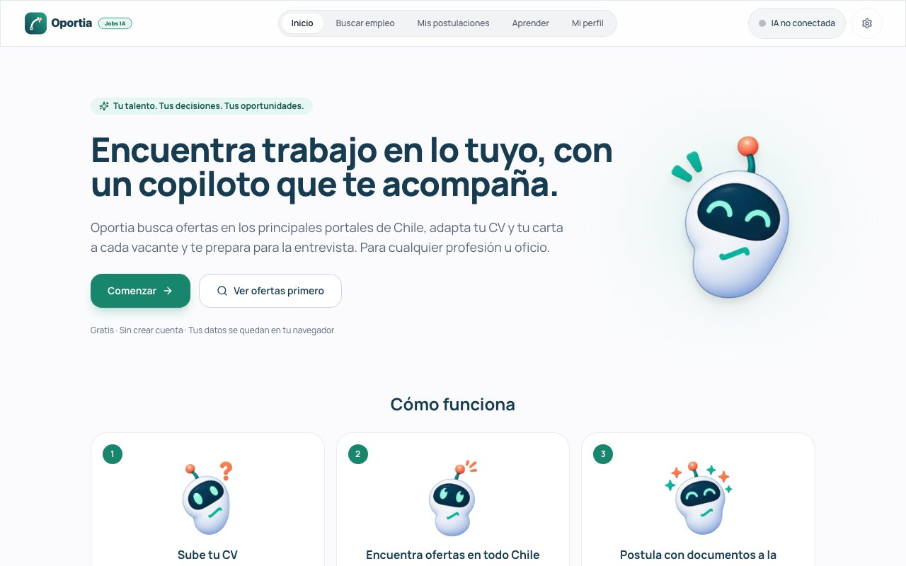

En el celular, Oportia funciona igual y tiene una barra de navegación abajo.

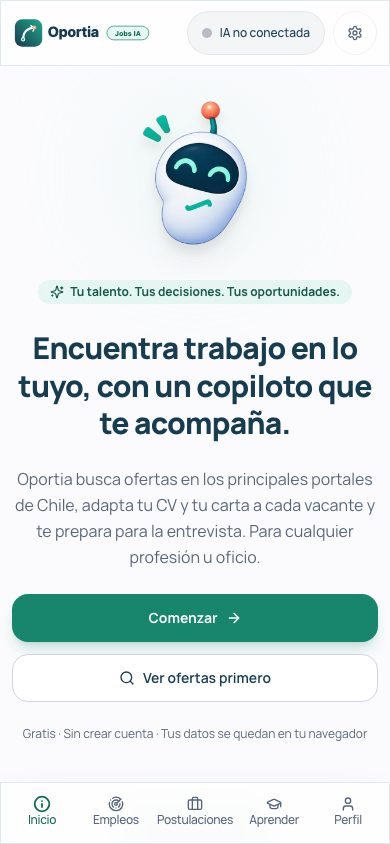

---

## 2. Primeros pasos: la guía de inicio

La guía tiene 3 pasos. Puedes cerrarla en cualquier momento (con la **X** o la tecla **Esc**) y repetirla después desde Inicio con **Repetir guía de inicio**.

**Paso 1 — Sube tu CV.** Arrastra tu archivo PDF, Word (DOCX) o TXT (máximo 10 MB). Oportia lee tu experiencia y tus habilidades **sin inventar datos**.

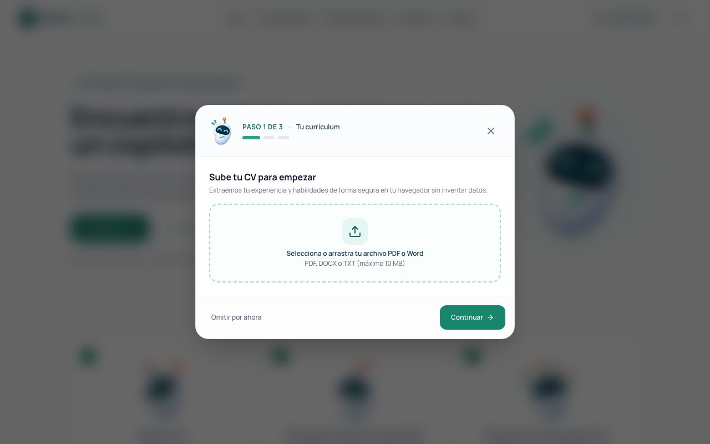

**Paso 2 — Cuéntanos qué buscas.** Escribe los cargos que te interesan, tu región y si quieres solo trabajo remoto.

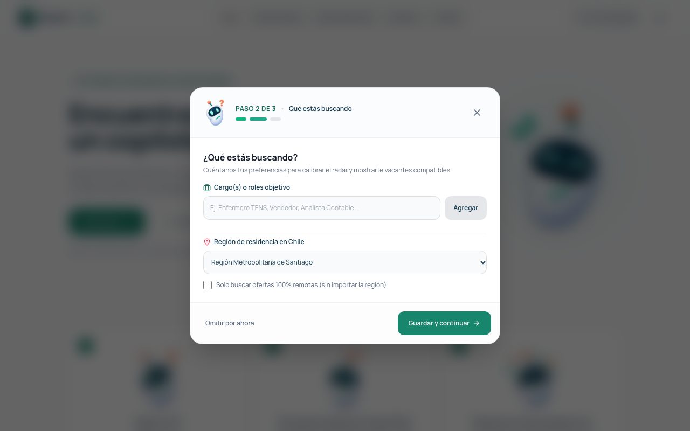

**Paso 3 — Conecta la IA (opcional).** Puedes activar la **IA gratuita de Oportia** o pegar tu propia clave de IA. Lo explicamos en la [sección 10](#10-ia-gratuita-o-tu-propia-clave). Si no quieres usar IA ahora, pulsa **Lo haré después**.

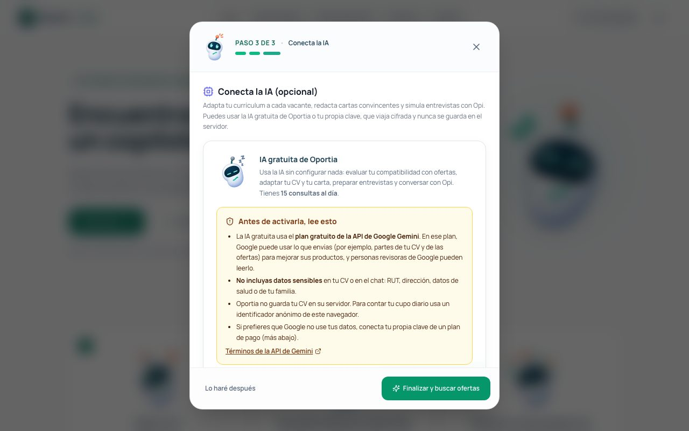

---

## 3. Inicio: tu siguiente paso

Inicio te dice **qué te conviene hacer ahora** ("Tu siguiente paso") y cuánto has avanzado en tu preparación:

- CV cargado y analizado
- Criterios de búsqueda definidos
- Motor de IA conectado (opcional)
- Primera postulación adaptada

A la derecha ves cuántas ofertas tienes en tu radar, cuántas postulaciones sigues y si la IA está activa. Cada tarjeta te lleva a su sección.

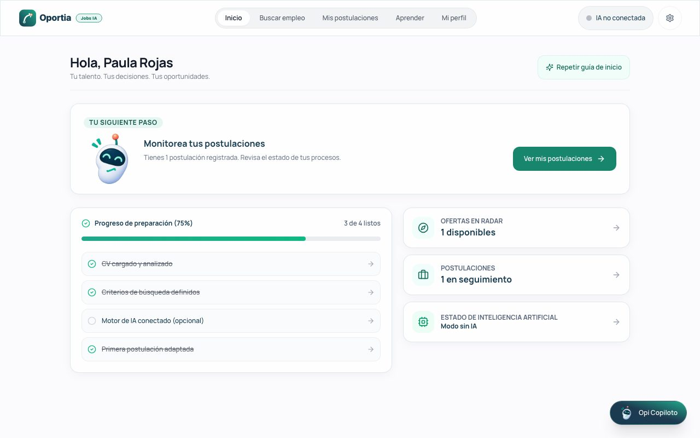

Oportia tiene **modo claro y modo oscuro**. Cámbialo en **Ajustes → Apariencia**.


---

## 4. Mi perfil: tu CV

En **Mi perfil → Mi CV** puedes:

1. **Subir CV (PDF/Word)** para cargarlo o reemplazarlo.
2. **Editar** tus datos de contacto, titular, resumen, experiencia, habilidades y educación.
3. Pulsar **Guardar cambios**.


### Ver y descargar tu CV en PDF

Pulsa **Ver mi CV** para abrir la vista previa. Elige la plantilla (Moderna, Minimalista o Ejecutiva), el tono del papel y la alineación del encabezado. Luego pulsa **Imprimir / Guardar PDF**.

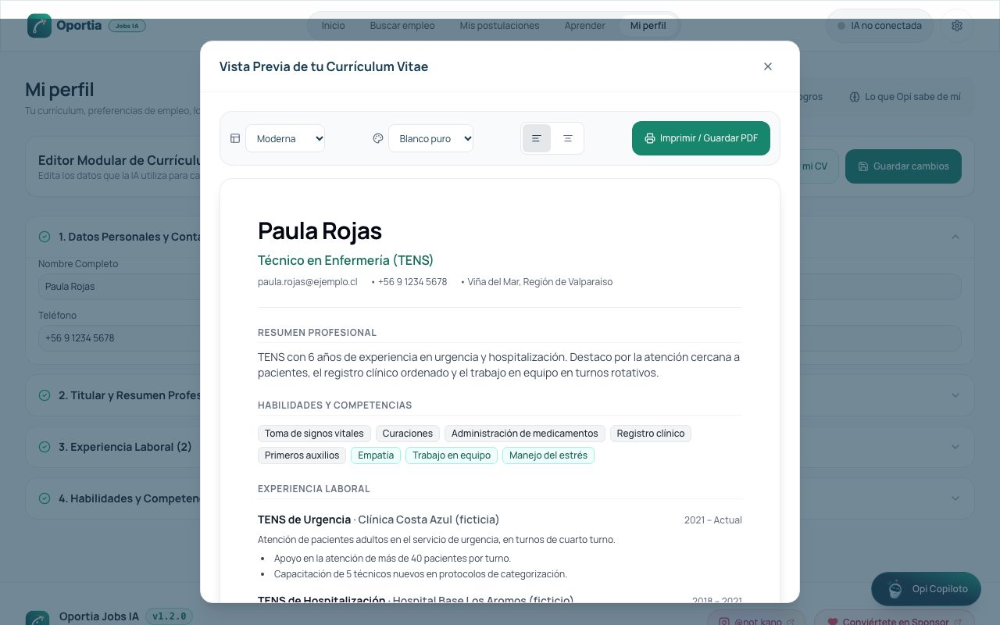

> 💡 **Para guardar como PDF:** en la ventana de impresión, elige **Destino → Guardar como PDF** (en Chrome) o **PDF → Guardar como PDF** (en Safari/Mac). El archivo se nombra solo, por ejemplo `CV - Paula Rojas.pdf`. El documento siempre se imprime en fondo blanco, aunque uses el modo oscuro.

Las otras pestañas de Mi perfil son **Qué busco**, **Mis logros** (tus logros en formato STAR) y **Lo que Opi sabe de mí** (lo que Opi aprendió de tus conversaciones).

---

## 5. Qué buscas: tus criterios

En **Mi perfil → Qué busco** defines los cargos objetivo, tu región y comunas, si quieres solo trabajo remoto, la renta mínima y lo que **no aceptarías** (por ejemplo, "turnos de 24 horas"). Oportia usa estos datos para buscar y para calcular tu compatibilidad.

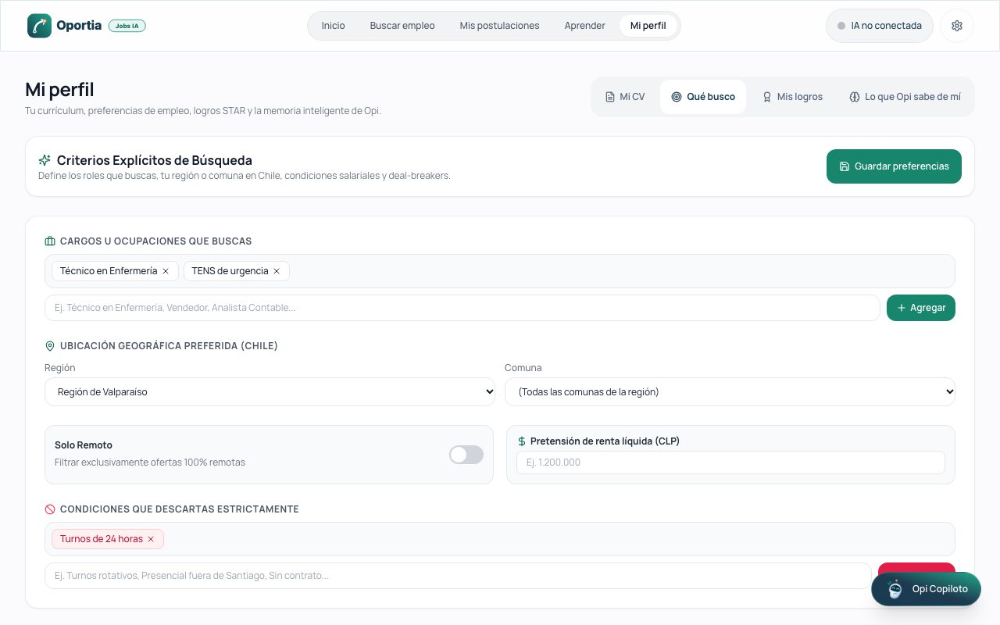

---

## 6. Buscar empleo

1. Escribe el cargo **como lo dirías tú**: "enfermera", "vendedor", "jefe de bodega", "educadora de párvulos".
2. Pulsa **Buscar**. Opi consulta los portales al mismo tiempo; demora unos segundos.
3. Filtra por modalidad (presencial, remoto), región ("Todo Chile" o "Solo mi región") u ordena por compatibilidad.

Oportia reconoce **sinónimos y equivalentes en inglés**: si buscas "enfermera" también encuentra "Técnico en Enfermería", "TENS" o "Registered Nurse". La etiqueta **Tu región** marca las ofertas cercanas a ti.


En cada oferta puedes:

- **Ver detalle**: descripción completa, fuente y enlace para postular en el sitio oficial.
- **Guardar**: la oferta pasa a **Mis postulaciones**.
- **Evaluar compatibilidad** (con IA): cinco evaluadores (Recursos Humanos, jefatura, evaluación técnica, ATS y orientación de carrera) revisan tu CV contra los requisitos de la oferta y citan la evidencia.

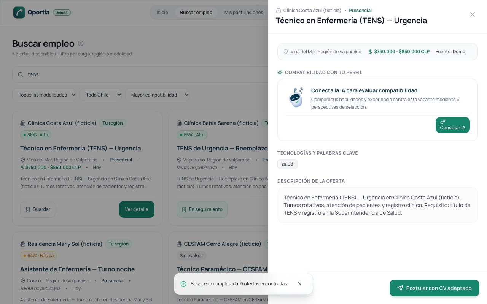

El menú **⋮** junto a "Buscar" tiene más opciones: **Importar oferta por URL** (pegas el enlace de una oferta que encontraste en otro sitio), **Ordenar ofertas con IA**, **Explorar portales de empresas** y **Vaciar ofertas del radar**.

> ℹ️ Si un portal no responde a tiempo, Oportia te avisa cuál fue y muestra lo que sí llegó. Puedes volver a intentar en unos minutos.

---

## 7. Mis postulaciones: CV, carta y entrevista

Aquí sigues cada proceso. Filtra por estado (Guardadas, Postuladas, En entrevista, Oferta, Cerradas) y cambia el **Estado** de cada postulación a medida que avanza.

Cada postulación tiene tres pestañas:

### 1. Documentos (CV y Carta)

- **Generar CV y carta adaptados** (o **Volver a adaptar con IA**): Opi reordena tu experiencia **real** según lo que pide la oferta. No inventa cargos, títulos ni empresas.
- Alterna entre **CV Base** y **CV Adaptado**, y descárgalo con **Imprimir / Guardar PDF**.


- En **Carta de Presentación** puedes **Copiar texto** o **Imprimir / PDF**.

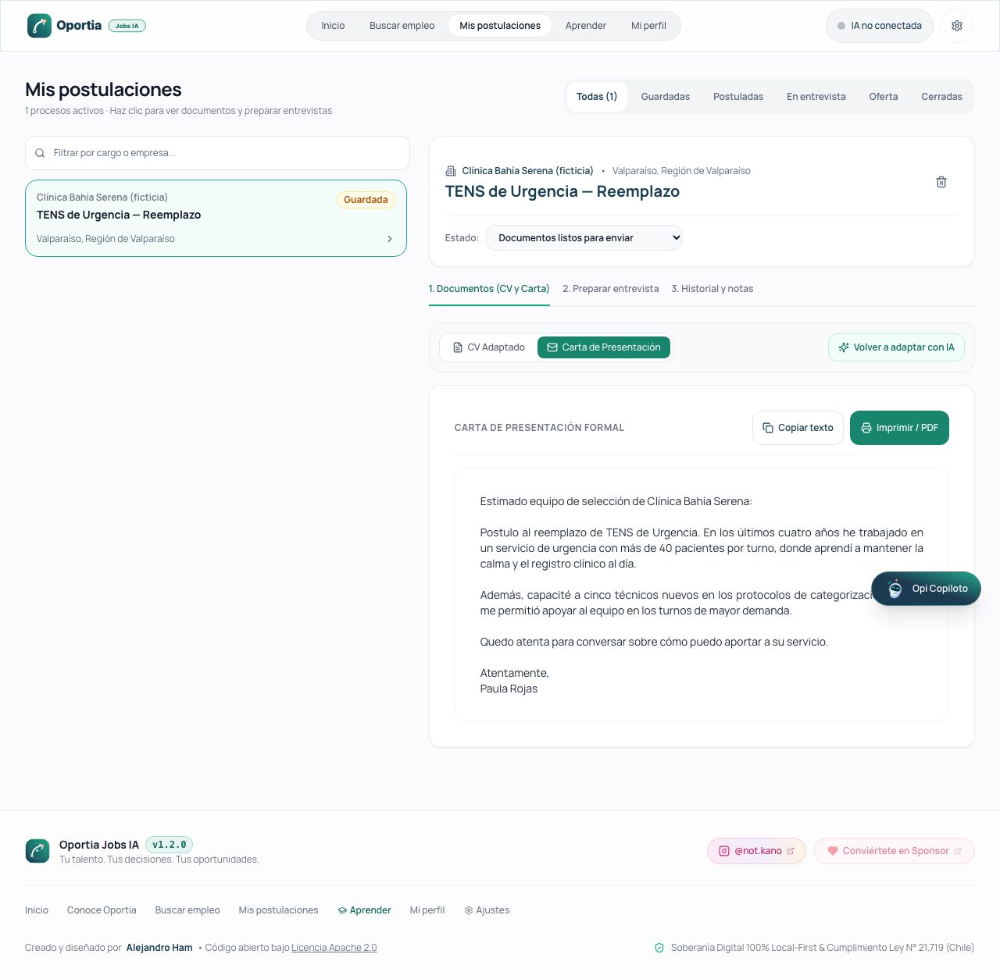

### 2. Preparar entrevista

Practica con preguntas pensadas para esa oferta. Responde con el método **STAR** (Situación, Tarea, Acción, Resultado). Con IA, recibes una evaluación de tu respuesta y sugerencias. También puedes **dictar por voz**.

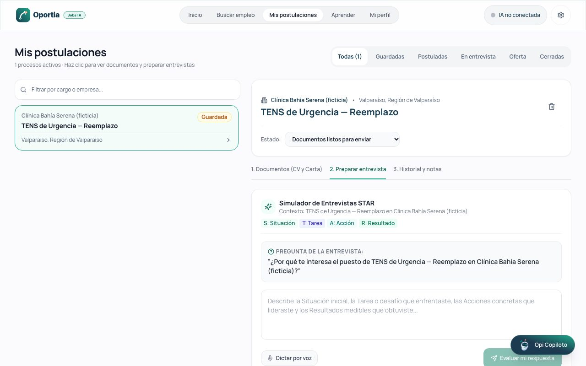

### 3. Historial y notas

Revisa la línea de tiempo del proceso (evaluaciones, documentos, postulación) y agrega tus propias notas de seguimiento.

> ✋ **Tú decides cuándo postular.** Oportia no envía postulaciones automáticas: tú postulas en el enlace oficial de cada oferta.

---

## 8. Aprender

**Aprender** te ayuda a cerrar brechas para las ofertas que te interesan:

- **Mis brechas**: habilidades que piden las ofertas y que aún no aparecen en tu CV.
- **Cursos**: cursos recomendados (busca por tema, por ejemplo "Excel" o "Prevención de riesgos").
- **Mi ruta**: un plan de estudio hacia el cargo que quieres.
- **Practicar**: desafíos prácticos evaluados con IA.


---

## 9. Opi, tu copiloto

Abre a Opi con el botón **Opi Copiloto** (abajo a la derecha). Puedes pedirle que:

- extraiga logros de tu CV en formato STAR,
- te explique cómo subir tu compatibilidad con una oferta,
- te recomiende cursos,
- registre lo que no aceptarías en un trabajo.

Opi recuerda lo que le cuentas y lo usa para orientarte; lo puedes revisar en **Mi perfil → Lo que Opi sabe de mí**.


Opi cambia de expresión según lo que pasa: **saluda**, **piensa** mientras trabaja, **celebra** tus avances, te **advierte** cuando una oferta tiene baja compatibilidad y **duerme** cuando la IA no está activa.

---

## 10. IA gratuita o tu propia clave

Buscar ofertas y armar tu CV **funciona sin IA**. Para evaluar compatibilidad, adaptar documentos, preparar entrevistas o conversar con Opi necesitas una de estas dos opciones, que se configuran en **Ajustes → Motor de IA**.

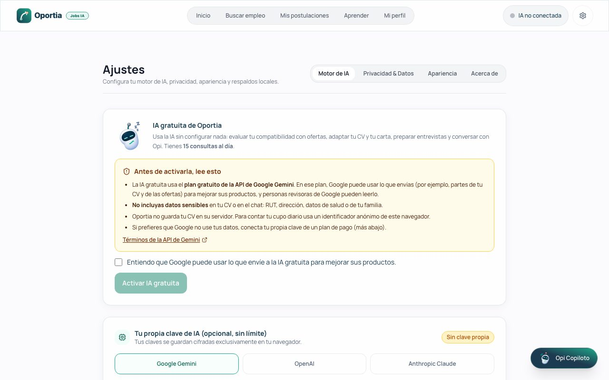

### Opción A: IA gratuita de Oportia

- No tienes que configurar nada. Tienes un **cupo diario de consultas** (Ajustes te muestra cuántas te quedan hoy).
- Antes de activarla debes leer y aceptar un aviso: usa el **plan gratuito de la API de Google Gemini**, en el que Google puede usar lo que envías para mejorar sus productos y personas revisoras pueden leerlo. **No incluyas datos sensibles** (RUT, dirección, datos de salud o de tu familia).
- Si se acaba el cupo verás: *"El servicio de IA está descansando un momento, intenta de nuevo en unos minutos."* Vuelve más tarde o al día siguiente, o conecta tu propia clave.
- Puedes dejar de usarla cuando quieras con **Dejar de usar IA gratuita**.

### Opción B: tu propia clave (sin límite)

1. Elige el proveedor: Google Gemini, OpenAI o Anthropic Claude.
2. Pega tu clave y pulsa **Guardar configuración**.

Tu clave se guarda **cifrada en tu navegador** y solo viaja al servidor en el momento de usar la IA; nunca se guarda en el servidor. Si conectas tu clave, Oportia la usa siempre en lugar de la IA gratuita. Con una clave de un plan de pago, el proveedor no usa tus datos para entrenar sus modelos.

---

## 11. Privacidad y respaldo de tus datos

- Tu CV, perfil, ofertas y postulaciones se guardan **solo en tu navegador**. Oportia no tiene cuentas ni guarda tu CV en su servidor.
- Como los datos viven en tu navegador, **si borras los datos del navegador o cambias de equipo, se pierden**. Por eso conviene descargar un respaldo.

En **Ajustes → Privacidad & Datos** puedes:

- **Descargar archivo (.oportia)**: un respaldo cifrado de todos tus datos.
- **Restaurar respaldo**: cargarlo en otro navegador o equipo.
- **Derecho al Olvido (Borrar Todo)**: eliminar todos tus datos de este navegador.

Más detalles en la [Política de Privacidad](../PRIVACY.md) (Ley N° 21.719).

---

## 12. Preguntas frecuentes

**¿Cómo guardo mi CV o mi carta en PDF?**
Pulsa **Imprimir / Guardar PDF** y, en la ventana que se abre, elige **Guardar como PDF** como destino.

**Busco y no aparecen ofertas. ¿Qué hago?**
Prueba con un término más general ("enfermería" en vez de "enfermera de pabellón pediátrico"), revisa que el filtro de región no sea demasiado estricto y vuelve a intentar si Oportia te avisó que algún portal no respondió.

**Me sale "El servicio de IA está descansando un momento".**
Se acabó el cupo de la IA gratuita por hoy o Google está con alta demanda. Intenta más tarde o conecta tu propia clave en Ajustes.

**¿Oportia sirve si no trabajo en tecnología?**
Sí. Oportia está pensado para todas las áreas y reconoce sinónimos de oficios y profesiones.

**¿Oportia postula por mí?**
No. Oportia prepara tus documentos y tú postulas en el sitio oficial de cada oferta.

**¿Cuánto cuesta?**
Oportia es gratuito y de código abierto ([Licencia Apache 2.0](../LICENSE)).

---

### Para quien mantiene Oportia: actualizar las capturas

Las capturas de este manual se generan automáticamente con datos de demostración:

```bash
cd frontend
npm run docs:screenshots
```

Las imágenes quedan en `docs/manual/img/`.
