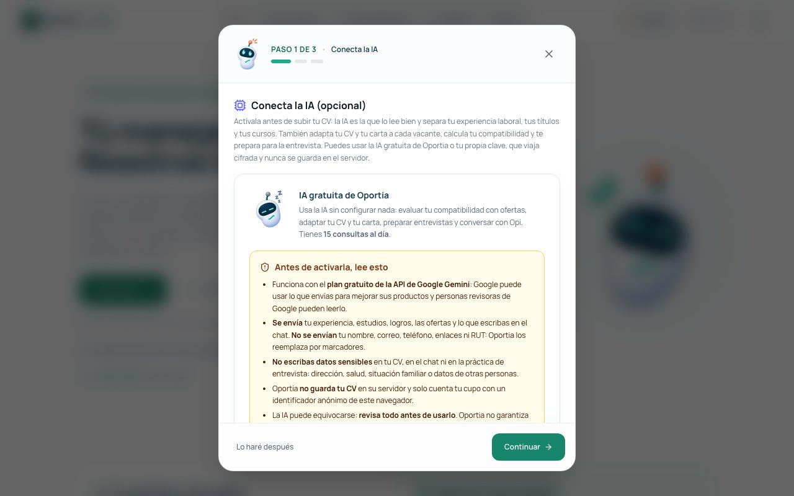
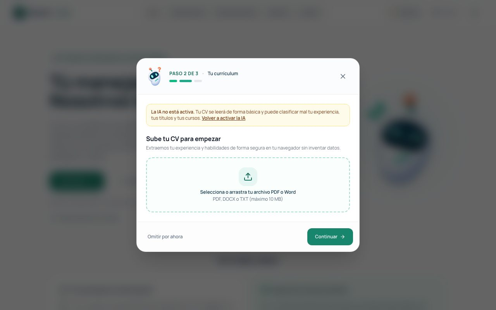
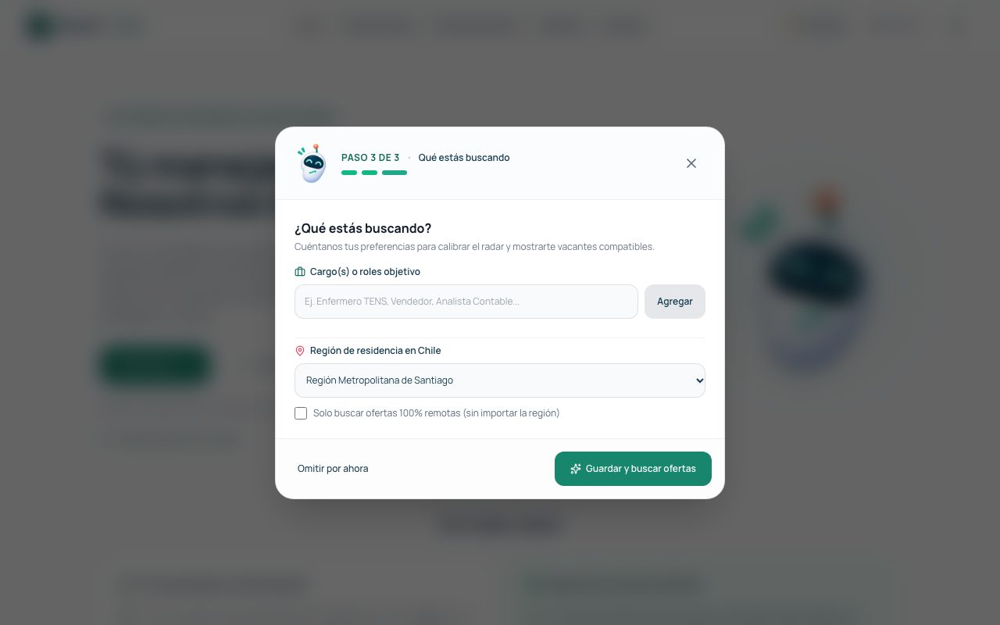
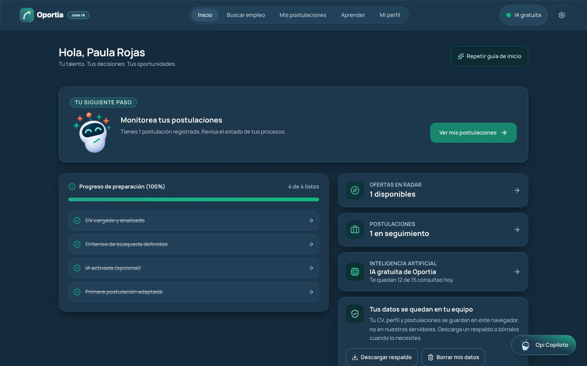
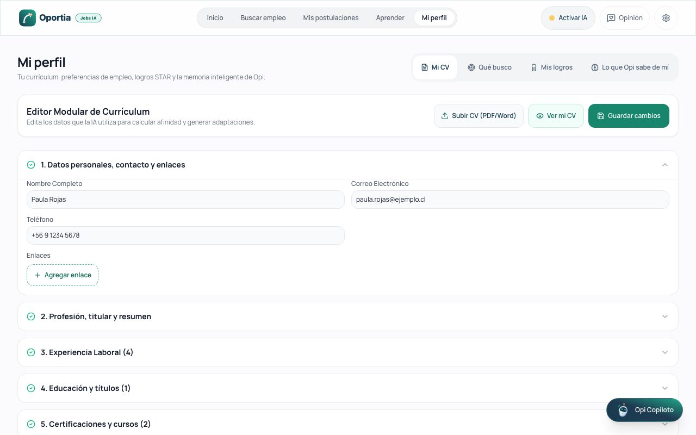
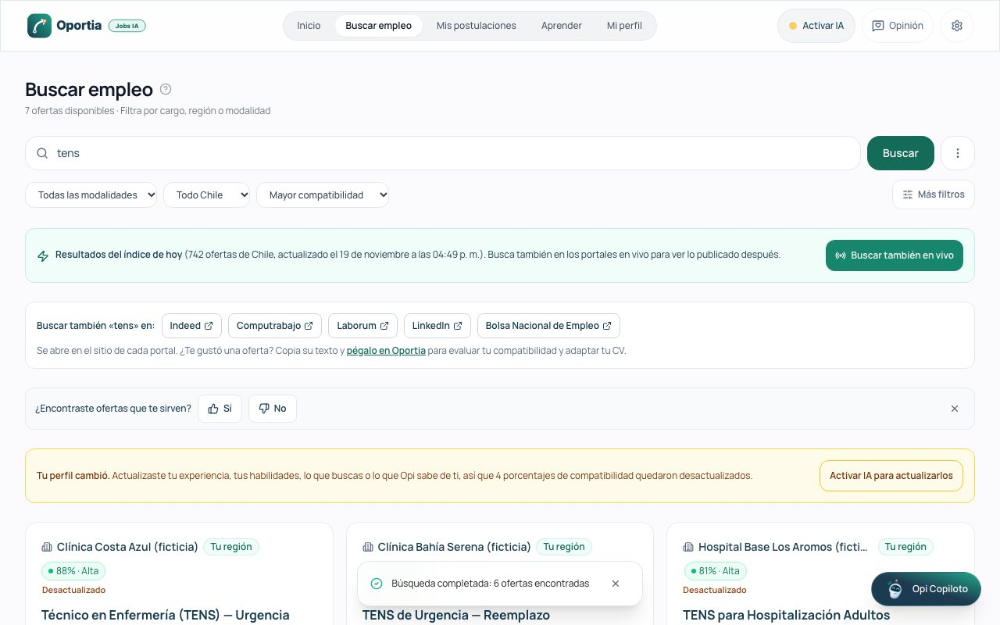
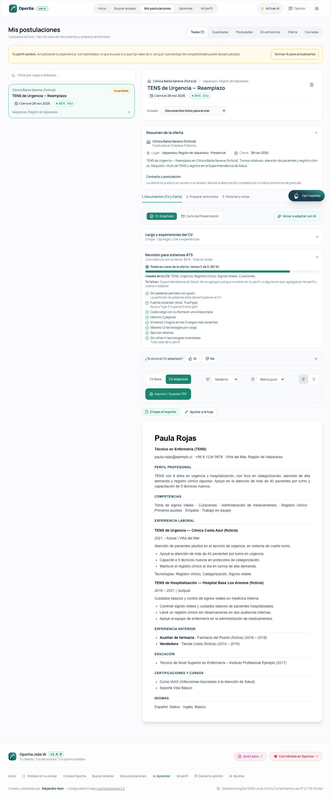
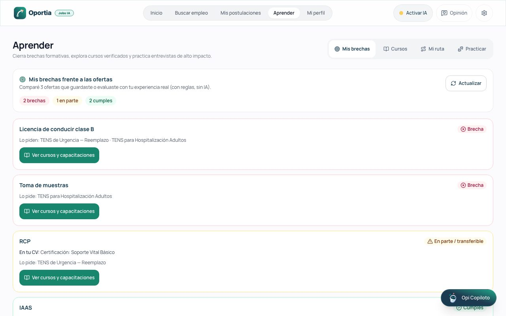
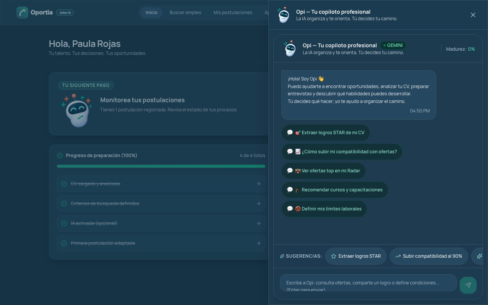

# Manual de usuario — Oportia Jobs IA

> Versión 1.6.0 · Guía paso a paso para encontrar trabajo con Oportia y Opi, tu copiloto.
>
> Las capturas muestran a **Paula Rojas**, una persona de demostración **ficticia** (Técnico en Enfermería). Las empresas que aparecen también son ficticias.

### Novedades de las versiones 1.4 a 1.6

- **CV compatible con sistemas ATS** (1.6): formato que leen bien los programas de selección, ajuste automático a 1 o 2 hojas, % de coincidencia con la oferta y revisión antes de descargar el PDF ([sección 7](#7-mis-postulaciones-cv-carta-y-entrevista)).
- **Nada inventado y tus datos exactos** (1.5): la IA no recibe tu nombre, correo, teléfono ni RUT; el encabezado del CV lo pone Oportia con los datos de tu perfil; lo que la IA agregue sin estar en tu perfil se quita y se te avisa.
- **IA gratuita con doble confirmación** y comprobante descargable (1.5) ([sección 10](#10-ia-gratuita-o-tu-propia-clave)).
- **Mi perfil:** región y comuna, orden por fecha o manual, y una lectura del CV que separa títulos, cursos, habilidades e idiomas (1.4–1.6) ([sección 4](#4-mi-perfil-tu-cv)).
- **Mis postulaciones:** resumen de la oferta con correo o enlace para postular, y largo y experiencias del CV (1.4) ([sección 7](#7-mis-postulaciones-cv-carta-y-entrevista)).
- **Recupera tus datos** desde la portada si cambias de equipo, y secciones que se activan con tu CV (1.4.6) ([sección 2](#2-primeros-pasos-la-guía-de-inicio)).
- **Opinar en un toque:** 👍/👎, tarjeta pequeña y botón Opinión en el menú (1.4.2) ([sección 12](#12-danos-tu-opinión)).

### Novedades de la versión 1.3

- **Ofertas cada mañana:** un índice diario de ofertas de Chile, con la fecha de vencimiento de cada una. Las vencidas se ocultan ([sección 6](#6-buscar-empleo)).
- **Tu compatibilidad, sin pedirla:** con la IA activa, cada oferta muestra tu porcentaje, y Oportia te avisa si tu perfil cambió ([sección 6](#6-buscar-empleo)).
- **Tu CV, bien leído:**
  - la IA separa experiencia, títulos y cursos;
  - "Reanalizar con IA" corrige tu perfil ([sección 4](#4-mi-perfil-tu-cv));
  - la experiencia ahora se puede editar.
- **Qué busco y Mis logros con IA:** cargos afines con su resumen y logros STAR desde tu CV; también desde el chat con Opi ([secciones 4, 5 y 9](#5-qué-buscas-tus-criterios)).
- **Danos tu opinión,** con contacto solo si lo autorizas ([sección 12](#12-danos-tu-opinión)).
- **"Borrar todos mis datos"** ahora pide dos confirmaciones y vuelve a la portada ([sección 11](#11-privacidad-y-respaldo-de-tus-datos)).

---

## Índice

1. [¿Qué es Oportia?](#1-qué-es-oportia)
2. [Primeros pasos: la guía de inicio](#2-primeros-pasos-la-guía-de-inicio)
3. [Inicio: tu siguiente paso](#3-inicio-tu-siguiente-paso)
4. [Mi perfil: tu CV](#4-mi-perfil-tu-cv)
5. [Qué buscas: tus criterios](#5-qué-buscas-tus-criterios)
6. [Buscar empleo](#6-buscar-empleo)
7. [Mis postulaciones: CV, carta y entrevista](#7-mis-postulaciones-cv-carta-y-entrevista)
8. [Aprender](#8-aprender)
9. [Opi, tu copiloto](#9-opi-tu-copiloto)
10. [IA gratuita o tu propia clave](#10-ia-gratuita-o-tu-propia-clave)
11. [Privacidad y respaldo de tus datos](#11-privacidad-y-respaldo-de-tus-datos)
12. [Danos tu opinión](#12-danos-tu-opinión)
13. [Para quien mantiene Oportia: índice diario y correo](#13-para-quien-mantiene-oportia-índice-diario-y-correo)
14. [Preguntas frecuentes](#14-preguntas-frecuentes)

---

## 1. ¿Qué es Oportia?

Oportia te ayuda a buscar trabajo **en cualquier área**: salud, educación, comercio, construcción, logística, administración, tecnología, sector público y oficios.

- **Busca al instante** en un **índice de ofertas de Chile que se actualiza cada mañana**. Viene de Empleos Públicos, GetOnBoard, los portales de empleo de las propias empresas y ChileTrabajos. Si quieres, también buscas **en vivo** en esos portales, en LinkedIn Chile y en sitios de trabajo remoto.
- **Te muestra cuándo vence cada oferta** y oculta las que ya cerraron.
- **Adapta** tu CV y tu carta de presentación a cada oferta y te deja **descargarlos en PDF**.
- **Te prepara** para la entrevista y te muestra qué habilidades te conviene reforzar.
- **Tú manejas tu información; nosotros te traemos las ofertas.** No necesitas crear una cuenta: tu CV y tus datos se guardan en tu navegador.

Al entrar por primera vez verás la portada. Pulsa **Comenzar** para abrir la guía de inicio o **Ver ofertas primero** si quieres explorar antes.


En el celular, Oportia funciona igual y tiene una barra de navegación abajo.


---

## 2. Primeros pasos: la guía de inicio

> **¿Ya usabas Oportia en otro equipo?** En la portada, pulsa **Recupera tus datos** y elige el archivo de respaldo (.oportia) que descargaste en tu otro equipo desde **Ajustes → Privacidad**. Si tiene contraseña, te la pedirá. Oportia no tiene cuentas: sin ese archivo no hay forma de traer tus datos, porque nunca se guardan en un servidor.

**Secciones que se activan con tu CV.** Mientras no subas tu CV, **Mis postulaciones** y **Aprender** muestran un candado 🔒 en el menú. Al entrar verás **Subir mi CV** y **Recuperar mis datos**. **Buscar empleo** y **Mi perfil** funcionan siempre. Si guardas ofertas antes de subir tu CV, **Mis postulaciones** se abre igual para que las veas.

La guía tiene 3 pasos. Puedes cerrarla en cualquier momento (con la **X** o la tecla **Esc**) y repetirla después desde Inicio con **Repetir guía de inicio**.

**Paso 1 — Conecta la IA (recomendado).** Activa la **IA gratuita de Oportia** o pega tu propia clave de IA (ver la [sección 10](#10-ia-gratuita-o-tu-propia-clave)). Va primero porque **la IA es la que lee bien tu CV**: separa tu experiencia laboral, tus títulos y tus cursos. Si prefieres no usarla ahora, pulsa **Lo haré después**.



**Paso 2 — Sube tu CV.** Arrastra tu archivo PDF, Word (DOCX) o TXT, de máximo 4 MB. Oportia lee tu experiencia, tus títulos y tus cursos **sin inventar datos**. Si la IA no está activa, verás un aviso: la lectura será básica y puede clasificar mal.



**Paso 3 — Cuéntanos qué buscas.** Escribe los cargos que te interesan, tu región y si quieres solo trabajo remoto. Al guardar, Oportia hace tu primera búsqueda.



---

## 3. Inicio: tu siguiente paso

Inicio te dice **qué te conviene hacer ahora** ("Tu siguiente paso") y cuánto has avanzado en tu preparación:

- CV cargado y analizado
- Criterios de búsqueda definidos
- Motor de IA conectado (opcional)
- Primera postulación adaptada

A la derecha ves cuántas ofertas tienes en tu radar, cuántas postulaciones sigues y si la IA está activa. Cada tarjeta te lleva a su sección.


Oportia tiene **modo claro y modo oscuro**. Cámbialo en **Ajustes → Apariencia**.



---

## 4. Mi perfil: tu CV

En **Mi perfil → Mi CV** puedes:

1. **Subir CV (PDF/Word)** para cargarlo o reemplazarlo. Si la IA no está activa, Oportia te pide activarla primero; también puedes seguir **sin IA** (lectura básica).
   - Al terminar, un aviso indica si el CV se analizó **con IA** o **sin IA**. Revisa cada sección y pulsa **Guardar cambios**.
   - **Reanalizar con IA** vuelve a leer el CV que ya cargaste, sin subirlo otra vez. Úsalo si se analizó sin IA o si algo quedó mal clasificado. Conserva tus palabras clave y tus enlaces.
2. **Datos personales** (nuevo en 1.5.0): nombre, **correo**, **teléfono**, **región** y **comuna de residencia**. Oportia te avisa si el correo o el teléfono no parecen válidos. Estos datos van **solo en el encabezado de tu CV, tal como los escribes**: la IA nunca los ve ni los puede cambiar.
3. **Editar** tus datos por secciones. En **Experiencia laboral**, pulsa cada trabajo para editar cargo, empresa, fechas ("Trabajo aquí actualmente"), ubicación, funciones, logros y herramientas. **Educación y títulos** guarda carreras, títulos y diplomados; **Certificaciones y cursos**, los cursos, capacitaciones y licencias. Las secciones son: contacto y **enlaces** (LinkedIn, portafolio, GitHub u otros), profesión y titular, experiencia, **varios títulos**, habilidades, **idiomas con nivel** y **Tecnologías y palabras clave**.
4. **Orden de tu CV** (nuevo en 1.4.3). La experiencia y la educación se ordenan **por fecha, de lo más reciente a lo más antiguo**: primero tu trabajo actual y los estudios en curso. Oportia entiende fechas como "2021", "03/2021", "Marzo 2021" o "Actual".
   - Si una fecha queda fuera de orden mientras editas, verás un aviso; **al guardar** se ordena sola, o puedes pulsar **Ordenar por fecha** de inmediato.
   - **¿Prefieres otro orden?** Usa las flechas **↑ ↓** en cada experiencia o título. Desde ese momento tu CV queda en **orden manual** y Oportia no lo reordena. Para volver al orden automático, pulsa **Ordenar por fecha**.
   - El CV adaptado de cada postulación respeta este mismo orden.
5. Pulsar **Guardar cambios**.

**Tecnologías y palabras clave.** Son los términos con los que te buscaría una empresa, por ejemplo "TENS", "Curaciones" o "Soporte TI".
- Al subir tu CV, Oportia agrega solas las palabras de tu área que **aparecen en tu CV**. Debajo te sugiere otras para que elijas.
- Oportia las usa para mostrarte ofertas **"Para ti"** y para marcar en cada oferta lo que **calza con tu perfil**.
- Con **Copiar para el aviso por correo** las copias para el correo diario de ofertas (ver la [sección 13](#13-para-quien-mantiene-oportia-índice-diario-y-correo)).

**También puedes actualizar tu perfil conversando con Opi.** Por ejemplo: "agrega Excel a mis habilidades", "tengo un diplomado en Gestión en Salud" o "mi LinkedIn es …". Opi te muestra el cambio y lo guarda solo si pulsas **Sí, guardar en mi perfil**.



### Ver y descargar tu CV en PDF

Pulsa **Ver mi CV** para abrir la vista previa. Elige la plantilla (Moderna, Minimalista o Ejecutiva), el tono del papel y la alineación del encabezado. Luego pulsa **Imprimir / Guardar PDF**.


> 💡 **Para guardar como PDF:** en la ventana de impresión, elige **Destino → Guardar como PDF** (en Chrome) o **PDF → Guardar como PDF** (en Safari/Mac). El archivo se nombra solo, por ejemplo `CV - Paula Rojas.pdf`. El documento siempre se imprime en fondo blanco, aunque uses el modo oscuro.

Las otras pestañas de Mi perfil son **Qué busco**, **Mis logros** y **Lo que Opi sabe de mí** (lo que Opi aprendió de tus conversaciones).

**Mis logros** guarda tus logros en formato STAR (Situación, Tarea, Acción, Resultado), útiles para la entrevista:
- Cuando la IA analiza tu CV, agrega sola los logros que encuentra en tu experiencia. Solo usa hechos de tu CV y no inventa cifras.
- **Extraer logros de mi CV con IA** vuelve a buscarlos cuando quieras.
- Cada logro indica su origen: "Desde tu CV (IA)", "Agregado con Opi" o "Agregado por ti".

---

## 5. Qué buscas: tus criterios

En **Mi perfil → Qué busco** defines los cargos objetivo, tu región y comunas, si quieres solo trabajo remoto, la renta mínima y lo que **no aceptarías** (por ejemplo, "turnos de 24 horas"). Oportia usa estos datos para buscar y para calcular tu compatibilidad.

**Cargos sugeridos según tu experiencia.** Cuando la IA analiza tu CV, Opi propone cargos afines, cada uno con un **resumen breve** de por qué calza contigo y los datos de tu CV que lo respaldan:
- **Tu experiencia directa:** cargos que ya ejerciste o sus equivalentes. Hasta 3 se agregan solos a lo que buscas.
- **Siguiente paso:** el ascenso natural según tus años y responsabilidades.
- **Por tus habilidades transferibles:** cargos de otra área donde sirve lo que sabes.

Pulsa **Agregar** en los que te interesen, o **Lo busco** para quitarlos. Con **Actualizar con IA** pides nuevas sugerencias cuando cambies tu CV.


---

## 6. Buscar empleo

1. Escribe el cargo **como lo dirías tú**: "enfermera", "vendedor", "jefe de bodega", "educadora de párvulos".
   - **Si no escribes nada**, Oportia busca ofertas **"Para ti"**, con tus palabras clave, tu profesión y tus habilidades.
2. Pulsa **Buscar**. Las ofertas llegan **al instante desde el índice de hoy**: verás el aviso **"Resultados del índice de hoy"**.
   - Para ver también lo que se publicó después, pulsa **Buscar también en vivo**. Opi consulta los portales al mismo tiempo; demora unos segundos.
   - Si el índice tiene pocas ofertas para tu búsqueda, Oportia busca en vivo por su cuenta.
3. Filtra por modalidad (presencial, remoto), región ("Todo Chile" o "Solo mi región") u ordena por compatibilidad.
   - En **Más filtros → Fuente** puedes ver solo las ofertas de **Portales de empresas**, **Empleos Públicos**, GetOnBoard, ChileTrabajos o LinkedIn.

Oportia reconoce **sinónimos y equivalentes en inglés**: si buscas "enfermera" también encuentra "Técnico en Enfermería", "TENS" o "Registered Nurse". La etiqueta **Tu región** marca las ofertas cercanas a ti.

**Tu porcentaje de compatibilidad se calcula solo.** Si tienes la IA activa, Oportia calcula el porcentaje de las ofertas que estás viendo apenas aparecen y las ordena de mayor a menor. No tienes que pulsar nada.
- Con la **IA gratuita**, que tiene cupo diario, se calcula la primera página de cada búsqueda. Para seguir con las demás, usa **⋮ → Ordenar ofertas con IA**.
- Con **tu propia clave**, se calcula cada página que ves.

**Si cambias tu perfil, Oportia te avisa.** Si actualizas tu experiencia, tus estudios, tus habilidades, lo que buscas o algo que Opi aprendió de ti en el chat, verás el aviso **"Tu perfil cambió"**:
- Cada porcentaje calculado con el perfil anterior muestra **"Desactualizado"**.
- Pulsa **Actualizar porcentajes** para recalcularlos con tu perfil actual.
- Cambiar tu correo, tu teléfono o tus enlaces no afecta la compatibilidad, así que no genera el aviso.

Cada tarjeta muestra:
- **Cuándo vence la oferta** (lo explicamos abajo).
- **Calza con tu perfil:** las palabras de tu perfil que aparecen en la oferta. "Mayor compatibilidad" usa esta afinidad cuando la oferta aún no tiene evaluación con IA.
- **Fuente:** dónde se publicó la oferta, con el enlace **Ver oferta original**.

### ¿Cuándo vence una oferta?

| Lo que trae la oferta | Fecha que muestra Oportia | Ejemplo |
|---|---|---|
| Fecha de cierre (por ejemplo, Empleos Públicos) | Esa fecha | **Cierra el 25 nov 2026** |
| Solo fecha de publicación | **Publicación + 30 días** | **Vence aprox. el 16 dic 2026 (estimado)** |
| Ninguna fecha | **45 días desde que Oportia la encontró** | **Vence aprox. el 31 dic 2026 (estimado)** |

- Si la oferta es del portal de una empresa, el plazo se renueva mientras la empresa la siga publicando.
- La etiqueta se pone **ámbar** cuando quedan 3 días o menos.
- Cuando una oferta vence, **desaparece de Buscar empleo** y del índice diario. Si la habías **guardado**, sigue en Mis postulaciones con la etiqueta **"Vencida el …"**, para que no pierdas tu historial.
- "(estimado)" significa que la oferta no publicó fecha de cierre. **Revisa siempre la fecha en el aviso original antes de postular.**



En cada oferta puedes:

- **Ver detalle**: descripción completa, fuente y enlace para postular en el sitio oficial.
- **Guardar**: la oferta pasa a **Mis postulaciones**.
- **Evaluar compatibilidad** (con IA): cinco evaluadores (Recursos Humanos, jefatura, evaluación técnica, ATS y orientación de carrera) revisan tu CV contra los requisitos de la oferta y citan la evidencia.


El menú **⋮** junto a "Buscar" tiene más opciones: **Importar oferta (pegar texto o enlace)**, **Ordenar ofertas con IA**, **Explorar portales de empresas** y **Vaciar ofertas del radar**.

### Ofertas de otros portales (Indeed, Computrabajo, Laborum, LinkedIn)

Algunos portales no permiten que otras apps lean o copien sus avisos, así que Oportia no los trae solo. Igual puedes usarlos:

1. Después de buscar, aparece **"Buscar también «tu cargo» en:"** con botones para Indeed, Computrabajo, Laborum, LinkedIn y la Bolsa Nacional de Empleo. Se abren **en el sitio de cada portal**, con tu misma búsqueda.
2. Si te gusta una oferta, **copia todo su texto**.
3. En Oportia, abre **⋮ → Importar oferta → Pegar texto**, pega el texto y, si quieres, su enlace. Pulsa **Ordenar y guardar**.
4. Oportia ordena el cargo, la empresa, la ubicación, la renta, la fecha de cierre y los requisitos, y la deja **guardada en Mis postulaciones**, solo para ti. Desde ahí evalúas tu compatibilidad, adaptas tu CV y postulas en el enlace original.

La pestaña **Enlace** sirve para sitios que sí permiten leer la oferta, como el sitio de una empresa o GetOnBoard. Con enlaces de Indeed, Computrabajo o Laborum, Oportia te pide pegar el texto.

> ℹ️ Si un portal no responde a tiempo, Oportia te avisa cuál fue y muestra lo que sí llegó. Puedes volver a intentar en unos minutos.

---

## 7. Mis postulaciones: CV, carta y entrevista

Aquí sigues cada proceso. Filtra por estado (Guardadas, Postuladas, En entrevista, Oferta, Cerradas) y cambia el **Estado** de cada postulación a medida que avanza.

Cada postulación muestra tu **porcentaje de compatibilidad** y **cuándo vence la oferta**. Si cambiaste tu perfil, aquí también aparece el aviso para **Actualizar porcentajes** de tus postulaciones.

Las fechas de vencimiento se ven en la lista y en el detalle, con las mismas reglas de la [sección 6](#cuándo-vence-una-oferta): "Cierra el …", "Vence aprox. el … (estimado)" o **"Vencida el …"**.

**Postular con CV adaptado.** En el detalle de una oferta, **Postular con CV adaptado** la guarda aquí y prepara tu CV y tu carta para esa oferta. Después solo revisas y postulas en el enlace oficial.

**Resumen de la oferta** (nuevo en 1.4.5). Al abrir una postulación, arriba de las pestañas verás:
- la **empresa** y dónde está publicada la oferta;
- los datos clave: lugar y modalidad, renta, tipo de contrato y fecha de cierre (si la oferta los indica);
- un **resumen** de la descripción, con **Ver descripción completa**;
- **Contacto y postulación:** el **correo** que publica la oferta (al pulsarlo se abre tu correo con el asunto listo) y el botón **Postular en…** con el enlace oficial. Si la oferta no publica correo, se postula desde el enlace.

Pulsa el título **Resumen de la oferta** para plegarlo y ahorrar espacio.

Cada postulación tiene tres pestañas:

### 1. Documentos (CV y Carta)

- **Largo y experiencias del CV** (nuevo en 1.4.2). Antes de generar, elige (cuando ya generaste un CV, este panel aparece plegado con un resumen, por ejemplo *1 hoja · Opi eligió: 3 de 6 experiencias*; púlsalo para abrirlo):
  - **El largo:** **1 hoja**, **2 hojas** o **Completo**. Si tienes más de 5 experiencias, Oportia sugiere 1 hoja.
  - **Que Opi elija:** Opi desarrolla las experiencias más relevantes para esa oferta y te muestra en una línea **por qué** eligió cada una.
  - **Elegir yo:** marca o desmarca tus experiencias. Se parte de lo que eligió Opi.
  - Las experiencias que no se desarrollan **no se ocultan**: van en **Experiencia anterior**, una línea por cargo (cargo, empresa y años). Esa sección la escribe Oportia con tus datos, no la IA, para que nada se invente.
- **Generar CV y carta adaptados** (o **Volver a adaptar con IA**): Opi reordena tu experiencia **real** según lo que pide la oferta y respeta el largo elegido. No inventa cargos, títulos ni empresas.
- **CV compatible con sistemas ATS** (nuevo en 1.6.0), los programas que usan las empresas para leer CV:
  - Oportia arma el CV con títulos estándar: *Perfil profesional, Competencias, Experiencia laboral, Experiencia anterior, Educación, Certificaciones y cursos* e *Idiomas*.
  - Cada cargo va así, una cosa por línea: **Cargo — Empresa**; **Mes Año – Mes Año | Ciudad**; una descripción breve; **3 a 5 logros**; y **Tecnologías:** con un máximo de 10, solo las que están en tu perfil. El cargo y la empresa se copian tal cual de tu perfil.
  - Máximo **2 hojas**, y **se ajusta solo**: si el CV se pasa del largo que elegiste, Oportia achica un poco la letra y, si no basta, lo acorta empezando por lo menos importante (Experiencia anterior, logros extra, tecnologías extra…). Nunca quita cargos, fechas ni estudios. Verás qué se acortó y podrás pulsar **Ver el CV completo**.
  - Los cargos que terminaron hace más de 10 años van en **Experiencia anterior**, una línea cada uno. Puedes quitar esa sección desmarcando **Incluir «Experiencia anterior»**.
  - El PDF usa la fuente **Arial** (nunca se parten palabras con guion) y se llama *CV – Tu nombre – Cargo de la oferta*.
  - **Revisión para sistemas ATS:** antes de descargar verás tu **% de coincidencia** con las palabras clave de la oferta, cuáles usaste y **cuáles te faltan** (no se agregan si no están en tu perfil), y una lista de chequeo: fechas en su línea, máximo 2 hojas, logros, tecnologías, sección Idiomas y nada inventado.
  - **Si un mismo cargo aparece dos veces con fechas o títulos distintos**, Oportia te pregunta cuál es el correcto antes de generar. No elige por ti.
- **Tus datos de contacto siempre van en el CV adaptado:** el encabezado lo arma Oportia con tu nombre, correo, teléfono, comuna y enlaces de **Mi perfil** (si los corriges, el CV ya generado se actualiza). Si falta alguno, verás un aviso para agregarlo.
- **Nada inventado:** después de que la IA escribe, Oportia compara el CV y la carta con tu perfil. Si la IA agregó una cifra, una fecha, una empresa, un cargo, un estudio, un curso o una competencia que no está en tu perfil, le pide corregirlo una vez y **quita lo que quede**. El aviso verde **"Oportia quitó… datos que la IA agregó sin estar en tu perfil"** te muestra qué se quitó. Si alguno es real, agrégalo en Mi perfil y vuelve a adaptar.
- El texto va **justificado** al ancho de la hoja, con división de palabras.
- **Medidor de hojas:** sobre la vista previa verás **Cabe en 1 hoja** o, por ejemplo, **2 hojas al imprimir**. Si se pasa del largo que pediste, aparece en amarillo.
- **Ajustar a la hoja:** reduce un poco la letra y los espacios (hasta un mínimo legible) para que el CV quepa en las hojas elegidas. **Tamaño normal** lo deja como estaba. Si ni así cabe, Oportia te sugiere quitar una experiencia o elegir un CV más largo.
- La **plantilla** (Moderna, Minimalista o Ejecutiva) y la **alineación** del encabezado ahora también se aplican al CV adaptado.
- Alterna entre **CV Base** y **CV Adaptado**, y descárgalo con **Imprimir / Guardar PDF**.



- En **Carta de Presentación** puedes **Copiar texto** o **Imprimir / PDF**.


### 2. Preparar entrevista

Practica con preguntas pensadas para esa oferta. Responde con el método **STAR** (Situación, Tarea, Acción, Resultado). Con IA, recibes una evaluación de tu respuesta y sugerencias. También puedes **dictar por voz**.


### 3. Historial y notas

Revisa la línea de tiempo del proceso (evaluaciones, documentos, postulación) y agrega tus propias notas de seguimiento.

> ✋ **Tú decides cuándo postular.** Oportia no envía postulaciones automáticas: tú postulas en el enlace oficial de cada oferta.

---

## 8. Aprender

**Aprender** te ayuda a cerrar brechas para las ofertas que te interesan:

- **Mis brechas**: Oportia compara los requisitos de las ofertas que **guardaste o evaluaste** (hasta 8) con tu CV:
  - ✅ **Cumples**, citando la evidencia de tu CV, por ejemplo "Certificación: Curso IAAS".
  - 🟡 **En parte o transferible**: tienes algo parecido.
  - ❌ **Brecha**: no aparece en tu CV.
  - Con IA, la comparación es más fina. Sin IA, se usan reglas para todas las áreas.
- **Cursos**: en cada brecha, **Ver cursos y capacitaciones** abre búsquedas en SENCE y OTEC, ChileValora, Coursera y edX. Cuando termines un curso, pulsa **Ya lo terminé** y Oportia lo suma a tus certificaciones.
- **Mi ruta**: un plan de estudio hacia el cargo que quieres.
- **Practicar**: desafíos prácticos evaluados con IA.



---

## 9. Opi, tu copiloto

Abre a Opi con el botón **Opi Copiloto** (abajo a la derecha). Puedes pedirle que:

- extraiga logros de tu CV en formato STAR,
- te explique cómo subir tu compatibilidad con una oferta,
- te recomiende cursos,
- registre lo que no aceptarías en un trabajo,
- actualice **lo que buscas**: "busco trabajo de jefe de obra", "agrega supervisor de obra a lo que busco", "ya no busco trabajo de capataz",
- agregue un **logro**: "agrega un logro: entregué la obra 2 semanas antes del plazo".

Opi te muestra el cambio y lo guarda solo si pulsas **Sí, guardar en mi perfil**.

Opi recuerda lo que le cuentas y lo usa para orientarte; lo puedes revisar en **Mi perfil → Lo que Opi sabe de mí**.



Opi cambia de expresión según lo que pasa: **saluda**, **piensa** mientras trabaja, **celebra** tus avances, te **advierte** cuando una oferta tiene baja compatibilidad y **duerme** cuando la IA no está activa.

---

## 10. IA gratuita o tu propia clave

Buscar ofertas y armar tu CV **funciona sin IA**. Para evaluar compatibilidad, adaptar documentos, preparar entrevistas o conversar con Opi necesitas una de estas dos opciones, que se configuran en **Ajustes → Motor de IA**.


### Opción A: IA gratuita de Oportia

- No tienes que configurar nada. Tienes un **cupo diario de consultas** (Ajustes te muestra cuántas te quedan hoy).
- **Para activarla confirmas dos cosas** (doble confirmación): que Google procesa lo que envías en su plan gratuito (puede usarlo para mejorar sus productos y personas revisoras pueden leerlo), y que tienes 18 años o más, no incluirás datos sensibles y revisarás lo que genere la IA.
- Antes de aceptar puedes **leer y descargar el aviso completo**, con la exclusión de responsabilidad (Oportia no garantiza entrevistas ni contrataciones).
- Al activarla, pulsa **Descargar mi comprobante**: es un documento con un código, la fecha, la versión del aviso y lo que aceptaste. Siempre puedes volver a descargarlo desde Ajustes.
- Oportia **no envía a la IA tu nombre, correo, teléfono, enlaces ni RUT**: los reemplaza por marcadores y los vuelve a poner en el resultado.
- Antes de activarla debes leer y aceptar un aviso: usa el **plan gratuito de la API de Google Gemini**, en el que Google puede usar lo que envías para mejorar sus productos y personas revisoras pueden leerlo. **No incluyas datos sensibles** (RUT, dirección, datos de salud o de tu familia).
- Si se acaba el cupo verás: *"El servicio de IA está descansando un momento, intenta de nuevo en unos minutos."* Vuelve más tarde o al día siguiente, o conecta tu propia clave.
- Puedes dejar de usarla cuando quieras con **Dejar de usar IA gratuita**.

### Opción B: tu propia clave (sin límite)

1. Elige el proveedor: Google Gemini, OpenAI o Anthropic Claude.
2. Pega tu clave y pulsa **Guardar configuración**.

Tu clave se guarda **cifrada en tu navegador** y solo viaja al servidor en el momento de usar la IA; nunca se guarda en el servidor. Si conectas tu clave, Oportia la usa siempre en lugar de la IA gratuita. Con una clave de un plan de pago, el proveedor no usa tus datos para entrenar sus modelos.

---

## 11. Privacidad y respaldo de tus datos

- Tu CV, perfil, ofertas y postulaciones se guardan **solo en tu navegador**. Oportia no tiene cuentas ni guarda tu CV en su servidor.
- Como los datos viven en tu navegador, **si borras los datos del navegador o cambias de equipo, se pierden**. Por eso conviene descargar un respaldo.

En **Ajustes → Privacidad & Datos** puedes:

- **Descargar archivo (.oportia)**: un respaldo cifrado de todos tus datos.
- **Restaurar respaldo**: cargarlo en otro navegador o equipo. También puedes hacerlo desde la portada con **Recupera tus datos**.
- **Borrar todos mis datos**: elimina todos tus datos de este navegador. Antes te pide dos confirmaciones ("entiendo que no se puede deshacer" y "no quiero descargar un respaldo") o te deja descargar el respaldo ahí mismo. Después vuelves a la portada y la guía de inicio parte de cero.

Más detalles en la [Política de Privacidad](../PRIVACY.md) (Ley N° 21.719).

---

## 12. Danos tu opinión

Opinar toma un segundo y nunca tapa lo que estás haciendo:
- **👍/👎 de un toque:** después de buscar ofertas o de generar un CV adaptado verás, por ejemplo, **¿Te sirvió el CV adaptado? Sí · No**. Se pregunta una sola vez en cada lugar; la **×** lo cierra para siempre. Después del toque puedes **Escribir (opcional)**.
- **Tarjeta de la esquina:** tras unos minutos de uso aparece una tarjeta pequeña abajo a la izquierda, **¿Cómo va tu experiencia con Oportia?**, con cinco caras. Un toque basta. Si la cierras, vuelve a aparecer como máximo una vez más.
- **Botón Opinión** en el menú superior, además del pie de página (**Danos tu opinión**) y la portada (**¿Qué te parece Oportia?**), para escribir con calma:
- Una **calificación de 1 a 5**, qué te sirvió y qué mejorarías.
- **Si quieres**, tu correo o teléfono para que te contactemos sobre mejoras o te invitemos a una entrevista. Solo se guardan si marcas la autorización; sin ella, el botón **Enviar opinión** no se activa.
- Al enviar, Oportia te muestra un **código**. Con él puedes pedir que borremos tu opinión o tu contacto.
- También encontrarás el enlace para **apoyar a Oportia con una donación**.

Si ya opinaste, la tarjeta no vuelve a aparecer. El tiempo de uso y las preguntas ya respondidas se guardan solo en tu navegador.

---

## 13. Para quien mantiene Oportia: índice diario y correo

Cada mañana, a las 08:00 de Chile, una tarea automática arma el **índice de ofertas** y, si está configurado, envía un **correo con las ofertas nuevas del día**.
- El correo trae solo ofertas que no habías recibido, máximo 2 por empresa, con enlace a la fuente original.
- La dirección de correo se guarda como secreto de GitHub y nunca aparece en el código.

Cómo configurarlo: [docs/INDICE_DIARIO.md](INDICE_DIARIO.md).

> ℹ️ Oportia **solo usa fuentes que permiten este uso**. Computrabajo y Laborum no están incluidos porque sus condiciones de uso prohíben el acceso automatizado y la reproducción de sus avisos. LinkedIn se usa solo en la búsqueda en vivo.

---

## 14. Preguntas frecuentes

**¿Cómo guardo mi CV o mi carta en PDF?**
Pulsa **Imprimir / Guardar PDF** y, en la ventana que se abre, elige **Guardar como PDF** como destino.

**Busco y no aparecen ofertas. ¿Qué hago?**
Prueba con un término más general ("enfermería" en vez de "enfermera de pabellón pediátrico"), revisa que el filtro de región no sea demasiado estricto, pulsa **Buscar también en vivo** y vuelve a intentar si Oportia te avisó que algún portal no respondió.

**Una oferta que vi ayer ya no aparece.**
Probablemente venció: Oportia oculta las ofertas cerradas o que superaron su plazo estimado (30 días desde su publicación, o 45 desde que Oportia la encontró). Si la habías guardado, sigue en **Mis postulaciones**.

**¿Qué significa "(estimado)" en la fecha?**
Que la oferta no publicó fecha de cierre y Oportia calculó una. Confirma la fecha en el aviso original antes de postular.

**¿Por qué no veo ofertas de Computrabajo o Laborum?**
Porque sus condiciones de uso no permiten que otros sitios lean y reproduzcan sus avisos de forma automática. Usa los botones **"Buscar también en"** para buscar en su sitio y, si te gusta una oferta, copia su texto y pégalo en **⋮ → Importar oferta → Pegar texto** (ver la [sección 6](#ofertas-de-otros-portales-indeed-computrabajo-laborum-linkedin)).

**Me sale "El servicio de IA está descansando un momento".**
Se acabó el cupo de la IA gratuita por hoy o Google está con alta demanda. Intenta más tarde o conecta tu propia clave en Ajustes.

**¿Oportia sirve si no trabajo en tecnología?**
Sí. Oportia está pensado para todas las áreas y reconoce sinónimos de oficios y profesiones.

**¿Oportia postula por mí?**
No. Oportia prepara tus documentos y tú postulas en el sitio oficial de cada oferta.

**¿Cuánto cuesta?**
Oportia es gratuito y de código abierto ([Licencia Apache 2.0](../LICENSE)).

---

### Para quien mantiene Oportia: actualizar las capturas

Las capturas de este manual se generan automáticamente con datos de demostración:

```bash
cd frontend
npm run docs:screenshots
```

Las imágenes quedan en `docs/manual/img/`.
